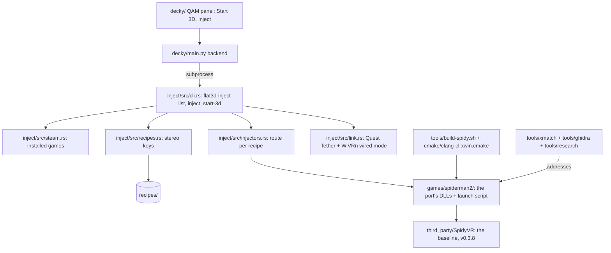

# Code map

One row per part of the repo: what it owns, who uses it and which Must it serves (SPEC.md). Written 2026-10-26 from the tree at main. The deep map of Spidy's stereo core is [spidy-stereo-core-map.md](spidy-stereo-core-map.md), and the Spider-Man 2 address map is [spiderman2-address-map.md](spiderman2-address-map.md).

Platforms (R04): the host is Linux (SteamOS on the owner's Z13) only (rulings 1, 2). The game DLLs are Windows binaries, cross-built on the Z13 with clang-cl + xwin and run under Proton. Mac and Windows hosts don't apply. CI runs `cargo build` + `cargo test` for the engine and byte-compiles the Decky backend on `ubuntu-latest`; the DLL build and every game test need the Z13.

## How it fits together

## Parts

| Path | Status | Owns | Musts |
|---|---|---|---|
| `third_party/SpidyVR` | present (submodule, v0.3.8) | the baseline mod (GPL-3.0): injection, stereo screen, probes | M1, M3-M8 |
| `cmake/clang-cl-xwin.cmake`, `tools/build-spidy.sh` | present | cross-building Windows DLLs on Linux in the `craft-build` distrobox (ruling 21) | M3-M8 |
| `tools/research/` | present | Spidy's discovery tools, with the Remastered hash gates removed so they read any PE32+ | M3-M5 |
| `tools/xmatch/` | present | the offline matcher from Remastered's addresses to Spider-Man 2's (`run_match.py A.exe B.exe out.json`) | M3-M6, M8 (pattern scans) |
| `tools/ghidra/headless.sh` | present | headless Ghidra as one heavy job, with a memory guard | M3-M6 |
| `games/spiderman2/` | planned | the port: render probe, camera shift, eye views, pairing, the OpenXR worker, HUD and memory, launch script | M3-M8 |
| `inject/` | skeleton (Rust crate `flat3d-inject`, std only) | the engine: `steam::installed_games`, `recipes::load_recipes`, `injectors::inject`, `link::start_3d` / `start_3d_commands`, `cli::parse` / `cli::run` (`flat3d-inject list / inject <appid> / start-3d`); every stub returns `Err(NotBuilt)`; unit tests are `#[test]`s in each module | M9, M10, M12 |
| `recipes/` | skeleton | one file per game with the eight stereo keys; the canonical home, by the owner's ruling (#15); the format is set by the recipes issue | M12 |
| `decky/` | skeleton (`plugin.json`, `main.py`) | the Game Mode plugin: the Python backend runs `bin/flat3d-inject` as a subprocess; the QAM panel (`decky/src/`) is planned | M11 |
| `docs/` | present | rulings (`notes/DECISIONS.md`), research, the port plan, Step 0 runsheet, maps | all |

## Open-source pieces

- [SpidyVR](https://github.com/IlyaMez/SpidyVR) (GPL-3.0): the baseline and the code the port comes from (ruling 17).
- [WiVRn](https://github.com/WiVRn/WiVRn): the streamer, used in its wired mode (ruling 5).
- Quest Tether (our own repo): the USB link layer that Start 3D brings up.
- [Rai Pal](https://github.com/Raicuparta/rai-pal) (GPL-3.0): the reference for game detection and the Inject flow (ruling 10). Its logic is ported to our Rust engine, not linked (both GPL-3.0).
- [Decky Loader](https://github.com/SteamDeckHomebrew/decky-loader): the Game Mode host.
- Ghidra and REA (ruling 22): reverse engineering for the address map.
