# Code map

The repository plan is [docs/ROADMAP.md](ROADMAP.md). This map describes the current Rust engine, app, Decky panel, routes and packaging.

**Ruling 42 (2026-11-10):** Flat to 3D and Quest Tether stay separate apps. WP-35..37 (`docs/plans/roadmap-v2/`) took the built-in tether out of the engine, the faces, Setup, install and packaging; only the adb choice stays, in `link/adb.rs`. WP-38 adds one read-only line with Quest Tether's state (`link/quest_tether.rs`). The internet over the cable is Quest Tether's job, not part of 1.0.

The deep maps are [Spidy core](spiderman2/spidy-core-map.md) and the [Spider-Man 2 address map](spiderman2/address-map.md) (with [clean-eye findings](notes/sm2-clean-eyes.md)).

**Platforms (R04).** The host is Linux only: SteamOS on the owner's handheld (rulings 1, 2). Mac and Windows hosts don't apply. Windows binaries (the Spider-Man 2 port's DLLs, the UEVR injector `flat3d-uevr-inject.exe`) are cross-built on Linux with clang-cl + xwin and run under Proton (ruling 21). The desktop app ships as an AppImage of the iced binary (no WebKitGTK). The Decky plugin bundles the engine binaries. The link service needs no root: `flat3d-inject install` puts in Flat to 3D's own udev rule for Meta USB devices (`packaging/flat3d-quest.rules`, one sudo prompt), so it does not rely on Quest Tether's rule (ruling 42, WP-37). CI is Linux only: GitHub-hosted `ubuntu-24.04` runners (ruling 48). The SBS viewer is a Linux-native binary.

## How it fits together

```mermaid
flowchart TD
    Steam["Steam: Play on a 3D Ready game"] --> Run["flat3d-run %command% (crates/engine/src/bin/flat3d-run.rs)"]
    Run -->|"reads"| State[("$XDG_RUNTIME_DIR/flat3d/link.json")]
    Run -->|"reads"| Cfg[("~/.config/flat3d/settings: switches")]
    Run -->|"3D: route files + env, else unchanged"| Game["the game (Proton)"]
    Run -->|"writes run record"| Runs[("runs/run-PID.txt")]
    Unit["systemd user unit flat3d-link"] --> Watch["crates/engine/src/watch.rs: flat3d-inject watch"]
    Watch -->|"adb track-devices"| Quest["Quest 2 over USB"]
    Watch --> Adb["crates/engine/src/link/adb.rs: one adb, running or bundled"]
    Watch --> Link["crates/engine/src/link.rs: WiVRn server + adb reverse + WiVRn app"]
    Watch --> Health["health.rs, watch/health_loop.rs: battery, temperature, heat toasts"]
    Watch -->|"atomic write"| State
    Watch -->|"reads"| Cfg
    Watch -->|"reads"| Runs
    Watch -.->|"status --json, read-only"| QT[(Quest Tether)]
    subgraph Faces
      App["crates/app/ — iced app (Rust): Setup, Headset, Games, Logs"]
      QAM["decky/ — thin TS panel: renders --json; SteamClient calls for launch options, collection, toasts"]
    end
    App -->|"links the crate (iced, depends by path)"| Engine
    QAM -->|"runs the binary, --json"| CLI["crates/engine/src/cli.rs + cli/"]
    CLI --> Engine
    subgraph Engine["crates/engine/ — Rust crate flat3d-inject (lib + bins flat3d-inject, flat3d-run)"]
      Steam2[steam.rs: installed games]
      Rec[recipes.rs: stereo keys]
      Inj[injectors/: uevr, geo11, port]
      Api[api.rs: the JSON shapes]
    end
    Run --> Inj
    Rec --> RecFiles[(recipes/)]
    Inj --> Games["games/&lt;game&gt;/ — per-game profiles, fixes, the SM2 port"]
    Inj --> Viewer["crates/viewer — SBS screen viewer (Linux, PipeWire→OpenXR)"]
    Inj -.only if UEVR's 2D screen is flat.-> Layer["layer/ — fixed-screen OpenXR layer"]
    Link --> WiVRn[(WiVRn server + headset app)]
    Tools["tools/ — build-spidy, xmatch, ghidra, research"] --> Games
```



<!-- mv-map -->
- `inject/**` → `crates/engine/**`
- `app/**` → `crates/app/**`
- `cli_link.rs` → `cli/link.rs`
- `{collection,headset_view,link_view,toasts,view}.rs` → `face/`
- `tether/mod.rs` → `tether.rs`
- `watch.rs` → `watch/service.rs`, then frames/machine/files/run are split out; new `watch.rs` is facade-only.
<!-- /mv-map -->

## Parts

A part that is fully built has exactly `present` in its Status cell, with nothing after it: locked tests check for that text (for example `api_response.rs`, `recipe_load.rs`, and #66's `link_stop.rs`). Partly built parts say `partly present (...)` or `present for ...`.

| Path | Status | Owns | Musts |
|---|---|---|---|
| `crates/engine/` | present | the engine: Rust crate `flat3d-inject`, library `flat3d_inject` + binaries `flat3d-inject` and `flat3d-run` (crate and library names kept: the locked tests in #24, #29, #36, #47-#49 import them). Everything the faces and the wrapper do goes through it; neither face runs a command itself. One part is still a stub: the port route (`injectors/port.rs`, below) | M9-M12, M17-M18, M26-M29 |
| `crates/engine/src/steam.rs` | present | `installed_games` (#24): installed Steam games from `libraryfolders.vdf` + `appmanifest_*.acf`, every library folder (internal, SD card, external drives); Kaon (LorenDB/kaon) and Rai Pal are the references | M9 |
| `crates/engine/src/recipes.rs` | present | `parse_recipe`, `check_recipe` and `load_recipes` (E1a-E1c): loads and checks `recipes/*.recipe` (`key: value`, the eight stereo keys plus route settings) | M12, M17, M20-M23 |
| `crates/engine/src/injectors.rs`, `crates/engine/src/injectors/` | present | one module per route, chosen by the recipe's `stereo-route` (`route_of`): `uevr.rs` (UEVR into the Proton prefix, profile: Zero Company, ACE COMBAT 7), `geo11.rs` (Geo-11 + the game's fix into the game folder, the viewer check: Control in 1.0, Planet of Lana after 1.0), `port.rs` (our DLLs + launch script: Spider-Man 2, Zero Company's fallback hook; a stub, so the Port route answers `not-built: port route: #27b`). `injectors.rs` has `route_of`, `check_injectable`, `inject`, `ensure_applied`, `RouteEnv`, `env_file_text` and `parse_env_file`. `inject` applies a route and saves its undo record; the wrapper calls `ensure_applied` (WP-31), so a route already applied is not applied twice. Neither writes Steam launch options nor starts the game. `inject <appid>` runs one by hand; device checks: Q6 (UEVR), Q9 (Geo-11) | M9, M14, M17, M20-M23 |
| `crates/engine/src/undo.rs` | present | the undo record (WP-27): how to put a game back to flat. `UndoRecord` holds the appid, the launch options before we touched them, the files created and the files replaced with their backups; `undo_actions` lists the ordered steps (created files newest first, then restores newest first, then the launch options last); `save_record`, `put_back` and `undo_game` run them. Known gap: folders the apply step made stay behind after undo (follow-up, see the ROADMAP) | M9 |
| `crates/engine/src/link.rs` | present | the WiVRn half of Start 3D and Stop 3D: WiVRn server without its desktop window (a user unit), `adb reverse tcp:9757`, the WiVRn app on the Quest; the replug's reattach list (reverse + app only) is `watch::link_commands(Reattach)`; a `LinkState` (no headset, unauthorised, starting, ready, stopped); commands behind a runner trait so tests fake them. Its submodules: `link/adb.rs` (the adb choice), `link/wivrn.rs` (WiVRn detection), `link/quest_tether.rs` (Quest Tether's state, read-only). Names kept: the locked tests in #64-#66 import them; device check: Q3 | M10, M18 |
| `crates/engine/src/watch.rs` + `watch/` | present | the link service's brain. `watch.rs` is a facade that re-exports `files.rs` (`write_snapshot`, `Paths`), `frames.rs` (`parse_track_frames`, adb track-devices), `machine.rs` (the pure state machine `step`: plug, unplug, Auto 3D, the 2-minute grace, late plug-in, manual Start/Stop, allow-debugging, returning `Effect`s; `link_commands`), `health_loop.rs`, `run.rs` (`watch::run`, the loop that ticks every second and writes the state file) and `service.rs` (`Service`, `Feed`, `TrackDevices`; Stop 3D through `link::stop_3d`, WP-09); device check: Q3 | M10, M18 |
| `crates/engine/src/state.rs` | present | the state directory paths, the `request` file (`start-3d` / `stop-3d`) and the staleness rule; the event ring (`EventRing`, E5g: the last 10 link events, numbered from one, `since`, resumed from a saved list). The state file's type `LinkSnapshot` (with `stopped` and `effective`, E5f) lives in `api.rs`; writing `link.json` is `watch::write_snapshot` (`watch/files.rs`). The one way the wrapper and both faces ask the link service anything | M9-M11, M18, M24 |
| `crates/engine/src/runs.rs` | present | `RunRecord`: one small file per running game (`runs/run-<pid>.txt`) that the wrapper writes, so the watcher knows which games run in 3D and which flat | M18 |
| `crates/engine/src/switches.rs` | present | `Settings` (`game_on`, `set_game`, `settings_text`, `parse_settings`, `read_settings`, `write_settings`): Auto 3D and the per-game 3D switches (on by default; only the off ones are stored) in `~/.config/flat3d/settings`; written by `setting set` / `switch set` (#120); an older settings line the engine no longer knows is skipped | M10, M11, M30 |
| `crates/engine/src/wrapper.rs` | present | the launch wrapper's decisions (WP-31): `plan` (3D with a route, or flat and why: `FlatReason`), `exec_spec` (the environment and command it execs), `prepare` (the pure decision over the file contents), and `run`, which reads the state file and the switch, applies the route through `injectors::ensure_applied`, writes the run record and log, then calls the launcher; device checks: Q6, Q9, Q10 | M9, M18, M30 |
| `crates/engine/src/bin/flat3d-run.rs` | present | the wrapper binary Steam runs: `flat3d-run %command%`; takes the appid from `SteamAppId` (else `SteamGameId`), calls `wrapper::run`, execs the game with its arguments passed as-is (no shell); prints only an exec error | M9, M30 |
| `crates/engine/src/link/adb.rs` | present | one adb (WP-35): `choose_adb` reuses a running server (`running_adb_exe`, `listener_pid`, `proc_exe_path`), else the bundled one (`tools_dir`, `bundled_adb`); `AdbRunner` swaps the adb word and adds `-s <serial>` except for server commands; device check: Q3 | M28 |
| `crates/engine/src/health.rs` | present | `health_command` and `parse_dumpsys_battery` (`dumpsys battery`), `temperature_zone` (the green/yellow/red zones, 38 C, 42 C), `ToastGate` (toast once) and `toast_text` | M26, M27 |
| `crates/engine/src/install.rs` | present | `install` / `uninstall` (WP-20, WP-37): `unit_text`, `unit_text_with`, `unit_path`, `bin_dir`, `install_plan`, `uninstall_plan`, `execute`, `execute_uninstall`; copies the binaries and adb into place, writes and enables the user unit, puts in Flat to 3D's own udev rule, and the reverse; device check: Q3 | M10, M28 |
| `crates/engine/src/setup.rs` | present | first-time setup checks: `packages_command`, `parse_packages`, `Packages` and `missing`, which tell whether the WiVRn app is on the Quest; the `setup` commands that run them are `cli/setup.rs` (WP-29) | M24 |
| `crates/engine/src/api.rs` | present | the serialisable types both faces read (`Game`, `Recipe`, `LinkState`, `InjectResult`, errors) and the `--json` output; the app uses them directly, the Decky panel reads the same keys | M9-M12 |
| `crates/engine/src/lib.rs`, `crates/engine/src/catalog.rs`, `crates/engine/src/exec.rs`, `crates/engine/src/fsx.rs`, `crates/engine/src/paths.rs`, `crates/engine/src/sys.rs`, `crates/engine/src/testing.rs` | present | `lib.rs`: the crate root, declares the modules and `NotBuilt` (the `not-built` error); `catalog.rs`: installed games joined to their recipes (`catalog`, `join`, `find_recipe`); `exec.rs`: the two runner seams the engine shares; `fsx.rs`: small filesystem steps; `paths.rs`: `EnginePaths`, every location from one environment snapshot; `sys.rs`: operating-system facts; `testing.rs`: helpers for the integration tests | M9-M12 |
| `crates/engine/src/cli.rs`, `crates/engine/src/cli/`, `crates/engine/src/main.rs` | present | `cli.rs`: the command line grammar (`parse_any`), the `COMMANDS` registry, `dispatch`, `render`, `exit_code`, `execute`, `run` and the `--json` envelope (names kept for the locked tests in #63); `main.rs` calls `cli::run`. One module per command group, see Commands below: `cli/engine.rs` (`list`, `status`, WP-07), `cli/inject.rs` and `cli/undo.rs` (WP-27), `cli/link.rs` (the link commands and `request_3d`, WP-08), `cli/view.rs` (the view commands, WP-28), `cli/setup.rs` and `cli/doctor.rs` (WP-29), `cli/setup_fetch.rs` (WP-27). Human text by default, `--json` for the Decky panel; device check: Q4 (`doctor`) | M9-M11, M18 |
| `packaging/` | present | `pins`, `pin.sh`, `lib.sh`, `build-tools.sh`, `build-appimage.sh`, `build-decky.sh`, `AppRun`, `flat3d.desktop`, `flat3d-link.service`, `flat3d-quest.rules`, `README.md`, `tests/` (WP-02, WP-22, WP-37): the pinned downloads list (`pins`, read by `injectors/fetch.rs`), `flat3d-link.service`, `build-tools.sh` (builds adb into `dist/tools/`; never in git), `flat3d-quest.rules` (the app's own udev rule for the Quest, ruling 42), the AppImage and Decky zip scripts; device checks: Q0, Q1, Q16 | M10, M28 |
| `crates/app/` | present | native Rust desktop app for Desktop Mode (iced, MIT; WP-04, WP-05, WP-06, WP-23, WP-33), a crate that depends on `crates/engine/` by path; Elm-style state and `update` functions are plain Rust and unit-tested; four pages; device check: Q15 | M24 |
| `crates/app/src/` | present | `lib.rs` (`Tab`, `App`, `Message`, `update`), `headset_page.rs` (WP-04), `setup_page.rs` (WP-05), `logs_page.rs` (WP-06), `games_page.rs` (WP-23): each page's state, messages and pure `update`, returning the engine action to run; `view_headset.rs`, `view_games.rs`, `view_setup.rs`, `view_logs.rs` (iced widgets, no logic, WP-33); `engine.rs` (the IO boundary and CLI adapter: reads the snapshot and writes requests itself, runs `flat3d-inject` for the rest, WP-33); `main.rs` (the iced window, a 1 s tick subscription, engine calls off the UI thread, WP-33). Pages: **Setup**, **Headset**, **Games** (each game with its 3D switch, recipe, Undo), **Logs**; no Library page and no Inject button | M24 |
| `decky/` | present | the Game Mode plugin (WP-21, WP-32: `plugin.json`, `package.json`, `rollup.config.js`, Decky's TypeScript + Rollup template). No Python backend logic (ruling 40): `main.py` is a shim that runs the engine binary `bin/flat3d-inject` with `--json` and makes the missing-binary and timeout errors; `tests/` checks the shim; device check: Q14 | M11, M18, M30 |
| `decky/src/` | present | `index.tsx`, `panel.tsx`, `engine.ts`, `types.ts`, `launch.ts`, `collection.ts`, `toasts.ts` (WP-21, WP-32): a thin QAM panel with no logic: it runs `flat3d-inject <command> --json` and draws the answer (link state with Start 3D / Stop 3D, headset health, the switches, then the 3D Ready games with a switch each); it calls Steam's own client only because only JavaScript can: `SteamClient.Apps.SetAppLaunchOptions` with the text from `launch add` / `launch remove`, `collectionStore` with the diff from `collection`, toasts from `toasts`; never touches cover art | M11, M18, M26, M30 |
| `crates/engine/src/launch_options.rs` | present | `add_wrapper`, `add_wrapper_at`, `remove_wrapper`, `has_wrapper` (E4b, WP-20): the rule the Decky plugin used to carry, now Rust: add and remove the `flat3d-run` word in a launch-option line (keeping `mangohud` and the rest) | M30 |
| `crates/engine/src/face/collection.rs`, `crates/engine/src/face/toasts.rs` | present | `collection.rs`: `three_d_ready_appids`, `collection_diff`, `COLLECTION_NAME`; `toasts.rs`: `toasts_since`, `ToastBatch`: the 3D Ready set and the collection diff, which toasts are new | M18, M26, M30 |
| `crates/engine/src/face.rs`, `crates/engine/src/face/view.rs` | present | `face.rs` declares the face modules; `view.rs` (`zone_colour`, `HealthView`, `health_view`): the battery and temperature wording and the zone colours, the one copy both faces read | M26, M27 |
| `crates/engine/src/face/rows.rs` | present | `GameRow`, `game_rows` (WP-03): shared game rows shown by both faces: sorted, filtered, with the 3D switch and the reason a game plays flat | M11, M24, M26 |
| `crates/engine/src/face/link_model.rs` | present | `link_view` (WP-28, WP-38): the `LinkView` model for a snapshot: label, hint, button states, health wording and the Quest Tether line | M11, M24, M26, M29 |
| `crates/engine/src/face/logs.rs` | present | `log_lines`, `read_logs`, `is_error_line` (WP-06): shared log reading and filtering for the `logs` command and the Logs page | M11, M24, M26 |
| `crates/engine/src/link/wivrn.rs` | present | `detect_server`, `detect_quest_app`, `WivrnDirs`, `QuestApp`, `WivrnStart`, `versions_match` (WP-12): WiVRn install and headset-app detection, and the version match between them; device check: Q3 | M10, M18 |
| `crates/engine/src/link/quest_tether.rs` | present | `status_command`, `parse_status`, `quest_tether_status`, `QuestTetherStatus` (WP-38): the link service runs `quest-tether status --json` at most every 10 s and keeps only its `state` text for the snapshot's `quest_tether`; it never starts, stops, heals or configures that link, and no decision depends on it (ruling 42); device checks: Q14, Q15 | M29 |
| `crates/engine/src/watch/health_loop.rs` | present | `HealthLoop`, `HealthTick` (WP-11, cut back by WP-36): every 30 s the battery and temperature through Flat to 3D's own adb, and the 38 C and 42 C toasts; each reading is appended to the health log; device check: Q3 | M10, M18, M26, M27 |
| `crates/engine/src/injectors/geo11.rs` | present | `Geo11Settings`, `from_route`, `plan_files`, `apply`, `viewer_check`, `d3dx_patch` (WP-16): the Geo-11 route: Geo-11 and the game's fix into the game folder, the `d3dx.ini` patch, the viewer check. 1.0 uses it for Control; Planet of Lana is after 1.0 (ruling 43). Known gap: `plan_files` can pick a stale cache version; device check: Q9 | M9, M17, M20-M23 |
| `crates/engine/src/injectors/port.rs` | stub (one comment line; #27b) | the port route: our DLLs + launch script (Spider-Man 2, Zero Company's fallback hook) | M9, M14, M17 |
| `crates/engine/src/injectors/fetch.rs`, `crates/engine/src/injectors/uevr.rs`, `crates/engine/src/injectors/uevr_profile.rs` | present | `fetch.rs` (`parse_pins`, `pin`, `fetch`, `is_fetched`, `cache_dir`, WP-13): pinned downloads from `packaging/pins` into the cache, checked by sha256; `uevr.rs` (`apply_with`, `debug_cmd`, `injector_path`, the profile text and folder, WP-14): the UEVR route into the Proton prefix, with the recipe's `uevr-profile` pin copied in (files it replaces are backed up and come back on undo); `uevr_profile.rs` (`read`, `merge_config`, #275): reads a fetched profile (layout rules ported from Kaon, GPL-3.0) and merges our keys into its `config.txt`; device checks: Q0, Q6 | M9, M14, M17 |
| `crates/engine/src/status.rs`, `crates/engine/src/face/headset_view.rs`, `crates/engine/src/face/link_view.rs` | present | `status.rs`: status labels, colours, sorting and filtering; `headset_view.rs`: button state and log lines; `link_view.rs`: link labels, hints and flat reason | M11, M24, M26 |
| `recipes/` | skeleton (README with the file format and the route settings; no `.recipe` files yet) | one file per game, the canonical home (#15); 1.0 ships six (rulings 43, 45): #29, #36, #47, #49, and one each for 007 First Light (F7, #298) and Alan Wake 2 (W7, #303; it has no Steam appid, so its file name and key wait on W1, #292); Planet of Lana's (#48) is after 1.0 | M12, M17, M20, M22, M31, M32 |
| `games/zero-company/`, `games/ace-combat-7/` | planned | UEVR profile settings, launch notes, measured settings | M13-M16, M20 |
| `games/control/` | planned | where the Geo-11 fix comes from (fetched, never vendored unless its license allows), settings | M22 |
| `games/planet-of-lana/` | planned, after 1.0 (ruling 43) | the same for Planet of Lana's Geo-11 fix | M23 (moved out of 1.0) |
| `games/007-first-light/` | planned | our `dinput8.dll` proxy that switches the engine's dormant VR device to its `stereo3d` mode, settings (planned route, untested) | M31 |
| `games/alan-wake-2/` | planned | our alternate-eye hook on the engine's camera class and its proxy DLL, settings (planned route, untested; ruling 44) | M32 |
| `games/spiderman2/` | planned | the port: render probe, camera shift, eye views, pairing, OpenXR worker, HUD and memory, launch script | M3-M8 |
| `crates/viewer/` | present | Linux-native PipeWire→OpenXR quad viewer on WiVRn: `flat3d-viewer` (features `xr`,`capture`); layout/status/spec pure; device check Q10 | M21 |
| `crates/uevr-inject/` | present | `flat3d-uevr-inject.exe` (WP-15), a small Windows binary run under Proton that injects UEVR into the running game; cross-built by `tools/build-win.sh`; device check: Q2 | M14 |
| `layer/` | planned, conditional | fixed-screen OpenXR layer, only if UEVR's 2D Screen Mode loses depth (#33, #9) | M15 |
| `third_party/SpidyVR` | present | the baseline mod (GPL-3.0), a submodule on v0.3.8; stays on v0.3.8 for Step 0, v0.7.0 read in the [version note](spiderman2/spidy-core-map.md#version-note-spidyvr-v038-and-v070-issue-38); device check: Q13 | M1, M3-M8 |
| `cmake/clang-cl-xwin.cmake`, `tools/build-spidy.sh` | present | cross-building Windows binaries on Linux in the distrobox build container (`$FLAT3D_BUILD_BOX`) | M3-M8, M21 |
| `tools/build-win.sh`, `tools/check.sh`, `tools/locked-test.sh` | present | `build-win.sh`: cross-builds the Windows binaries (the UEVR injector); `check.sh`: the one gate CI and people run (`--only rust\|py\|decky`, `--ci`); `locked-test.sh`: checks an issue's `## Tests (locked)` block against its expected sha256 | all |
| `tools/docs/`, `tools/pm/`, `tools/session/`, `tools/stereo/`, `tools/re/`, `sessions/` | present | `docs/check.py`: the docs rules (status paths, links, mermaid, the Commands table against every `usage: flat3d-inject` line, where only a spaced ` \| ` outside brackets separates commands (#273), private terms); `pm/issues_report.py`: issue readiness and scope checks; `session/session.py` and `sessions/*.toml`: the on-device check sessions (the Q rows); `stereo/`: frame-rate and disparity measurements; `re/` (WP-30): `analyze.sh`, `exe_id.py` and `fill_map.py`, the address map generator (device check: Q12) | all |
| `tools/research/`, `tools/xmatch/`, `tools/ghidra/` | present | Spider-Man 2 discovery: Spidy's tools without hash gates, the Remastered → SM2 matcher, headless Ghidra under a memory guard | M3-M6, M8 |
| `crates/engine/tests/*.rs`, `crates/engine/tests/fixtures/recipe-seeds/` | present | Engine behavior and locked contract tests; the recipe seeds (WP-26) are test fixtures, not shipped recipes | all |
| `.github/workflows/check.yml`, `.github/workflows/appimage.yml` | present | CI on GitHub-hosted `ubuntu-24.04` runners (ruling 48, #270). `check.yml` has three jobs, each running `tools/check.sh --ci --only <gate>`: `rust` (fmt, clippy `-D warnings`, the viewer with `xr,capture`, the UEVR injector for Windows, `cargo test --workspace`), `py` (py_compile, unit tests, Decky shim tests, the docs check) and `decky` (typecheck and build); `appimage.yml` builds the AppImage | all |
| `docs/` | present | rulings (`notes/DECISIONS.md`), research, the port plan, Step 0 run sheet, maps | all |

## Commands

Entries follow `cli::COMMANDS` order (`crates/engine/src/cli.rs`): Group, JSON and Effects copy each entry's `group`, `output` and `effects`. Modules are under `crates/engine/src/`. A command with no JSON type (`watch`, `run`) prints no JSON: it runs the service or execs the game.

| Command | Group | Module | JSON (api.rs type) | Effects | WP |
|---|---|---|---|---|---|
| `list` | Engine | `cli/engine.rs` | `Game (array)` | ReadOnly | WP-07 |
| `inject` | Engine | `cli/inject.rs` | `InjectResult` | WritesFiles, RunsCommands | WP-27 |
| `start-3d` | Engine | `cli/link.rs` (`request_3d`)` | `LinkReport` | WritesFiles | WP-08 |
| `stop-3d` | Engine | `cli/link.rs` (`request_3d`)` | `LinkReport` | WritesFiles | WP-08 |
| `status` | Engine | `cli/engine.rs` | `LinkReport` | ReadOnly | WP-07 |
| `undo` | Engine | `cli/undo.rs` | `UndoResult` | WritesFiles | WP-27 |
| `watch` | Link | `cli/link.rs` | — | WritesFiles, RunsCommands | WP-08 |
| `snapshot` | Link | `cli/link.rs` | `LinkSnapshot` | ReadOnly | WP-08 |
| `install` | Link | `cli/link.rs` | `InstallReport` | WritesFiles, RunsCommands | WP-08 |
| `uninstall` | Link | `cli/link.rs` | `InstallReport` | WritesFiles, RunsCommands | WP-08 |
| `switch get` | Link | `cli/link.rs` | `SwitchState` | ReadOnly | WP-08 |
| `switch set` | Link | `cli/link.rs` | `SwitchState` | WritesFiles | WP-08 |
| `setting get` | Link | `cli/link.rs` | `SettingState` | ReadOnly | WP-08 |
| `setting set` | Link | `cli/link.rs` | `SettingState` | WritesFiles | WP-08 |
| `run` | Link | `cli/link.rs` | — | WritesFiles, RunsCommands | WP-08 |
| `view` | View | `cli/view.rs` | `LinkView` | ReadOnly | WP-28 |
| `rows` | View | `cli/view.rs` | `GameRow (array)` | ReadOnly | WP-28 |
| `launch` | View | `cli/view.rs` | `LaunchText` | ReadOnly | WP-28 |
| `collection` | View | `cli/view.rs` | `CollectionPlan` | ReadOnly | WP-28 |
| `toasts` | View | `cli/view.rs` | `ToastBatch` | ReadOnly | WP-28 |
| `logs` | View | `cli/view.rs` | `LogLines` | ReadOnly | WP-28 |
| `setup packages` | Setup | `cli/setup.rs` | `{wivrn,missing}` | Probes | WP-29 |
| `setup install-apps` | Setup | `cli/setup.rs` | `SetupReport` | WritesFiles, RunsCommands | WP-29 |
| `setup launch-env` | Setup | `cli/setup.rs` | `LaunchText` | Probes | WP-29 |
| `setup fetch` | Setup | `cli/setup_fetch.rs` | `SetupReport` | WritesFiles, RunsCommands | WP-27 |
| `doctor` | Doctor | `cli/doctor.rs` | `DoctorReport` | Probes | WP-29 |

Binaries that do not go through `parse_any`:

- `flat3d-run %command%`: the launch wrapper Steam runs (`crates/engine/src/bin/flat3d-run.rs`; it calls `wrapper::run`, the same work as `run`).
- `flat3d-viewer`: the SBS screen viewer; its arguments come from `ViewerSpec::to_args` (`crates/viewer/src/spec.rs`).
- `flat3d-uevr-inject.exe`: the UEVR injector run under Proton; its arguments are parsed in `crates/uevr-inject/src/args.rs`.

## API shape (crates/engine/src/api.rs)

`api.rs` owns the eight error codes and `error_help`; this table copies those values. Exit codes come from `cli::exit_code`.

| Code | Exit | Retryable | Fix (`api::error_help`) |
|---|---:|---|---|
| `usage` | 2 | no | check the command against the usage line in the message |
| `not-built` | 2 | no | the message names the work package that builds it |
| `not-found` | 1 | no | check the name or path; `flat3d-inject list` shows installed games |
| `bad-recipe` | 1 | no | fix the recipe file named in the message |
| `refused` | 1 | no | do what the message names first, then run the command again |
| `link-not-ready` | 1 | yes | `systemctl --user restart flat3d-link.service` |
| `command-failed` | 1 | yes | check the command named in the message, then run it again |
| `io` | 1 | yes | check the path in the message, then run the command again |


Fixed 2026-10-31 when #50 was split (E1d #61 types, E1e #62 envelope, E1f #63 `--json`) and extended 2026-11-01 for "Plug in and play"; the locked tests in those issues hold the old names (kept as they are), and the app (by crate) and the Decky panel (by `--json`) read exactly this. Rust field name = JSON key.

Every `flat3d-inject <command> --json` prints exactly one line holding one JSON object, the envelope `Response<T>`:

```json
{"ok": true,  "command": "list", "data": [ ... ]}
{"ok": false, "command": "list", "error": {"code": "not-built", "message": "not built yet: ..."}}
```

`data` is left out on failure and `error` on success. A bad command line gives `"command": ""` and code `usage`. Exit code: 0 ok; 2 for `usage` and `not-built`; 1 for every other error. Without `--json`, results go to stdout as text and errors to stderr as `error: <message>`. `watch` and `run` are not JSON commands: `watch` runs until stopped (the systemd unit), `run` ends by exec-ing the game and prints nothing.

| Command | `command` | `data` |
|---|---|---|
| `list` | `"list"` | array of `Game` |
| `inject <appid>` (internal: what `run` does for a 3D launch, kept for hand testing; no face shows it) | `"inject"` | `InjectResult` |
| `start-3d`, `stop-3d`, `status` | `"start-3d"`, `"stop-3d"`, `"status"` | `LinkReport` |
| `undo <appid>` (#84) | `"undo"` | `UndoResult` (files put back; the launch option is the Decky plugin's to remove) |
| `snapshot` (new) | `"snapshot"` | `LinkSnapshot`: the whole state file, with health and the Quest Tether state |
| `switch get <appid>`, `switch set <appid> on\|off` (new) | `"switch"` | `SwitchState` |
| `setting get <key>`, `setting set <key> on\|off` (new; key `auto-3d`) | `"setting"` | `SettingState` |
| `install`, `uninstall` (new) | `"install"`, `"uninstall"` | `InstallReport` |
| `view` (new) | `"view"` | `LinkView`: the link wording, button states and health wording for the current snapshot |
| `rows [--filter <status>\|all]` (new) | `"rows"` | array of `GameRow`, sorted, with labels, colours, each game's switch and why it would play flat |
| `launch add\|remove <options>` (new) | `"launch"` | `LaunchText` |
| `collection [--current <appids>]` (new) | `"collection"` | `CollectionPlan` |
| `toasts <last_seq>` (new) | `"toasts"` | `ToastBatch` |
| `logs [--limit <n>]` (new) | `"logs"` | `LogLines` |
| `setup packages` | `"setup"` | `{wivrn, missing}`: whether the WiVRn app is on the Quest, and what is missing |
| `setup install-apps`, `setup fetch` | `"setup"` | `SetupReport` |
| `setup launch-env` | `"setup"` | `LaunchText` |
| `doctor` | `"doctor"` | `DoctorReport`; a red report exits 1 and still prints the whole report (ruling D4) |
| `watch` (new) | none | runs the link service |
| `run <appid> -- <command...>` (new; `flat3d-run` calls it with the appid from `SteamAppId`) | none | execs the game |

| Type | Keys |
|---|---|
| `Game` | `appid` (number), `name`, `install_dir` (path as text), `status` (the recipe's `stereo-status`, `untested` when there is no recipe), `has_recipe` (bool) |
| `Recipe` | `appid`, `name`, `status`, `route`, `engine`, `api`, `mod_url`, `free`, `safe`, `checked`: the fields of `recipes::Recipe` |
| `LinkState` | a string: `"no-headset"`, `"unauthorised"`, `"starting"`, `"ready"`, `"stopped"` |
| `LinkReport` | `state` (`LinkState`), `message` (one line for people); unchanged by the rework |
| `InjectResult` | `appid`, `route`, `launched` (bool), `summary` |
| `UndoResult` | `appid`, `restored` (array of text, one line per change put back, from the undo record #81), `summary` |
| `Zone` | a string: `"green"` (below 38 C), `"yellow"` (38-42 C), `"red"` (above 42 C), `"unknown"` |
| `Health` | `battery` (number 0-100 or null), `status` (text: `Charging`, `Discharging`, `Not Charging`, `Full`, `Unknown`), `temp_c` (number or null), `zone` (`Zone`) |
| `LinkEvent` | `seq` (number, rises by one), `kind` (`ready`, `late-plug`, `grace-ended`, `allow-debugging`, `warm`, `hot`), `text` (the toast wording, made by the engine so both faces say the same thing) |
| `LinkSnapshot` | `state` (`LinkState`), `message`, `auto_3d` (bool), `adb` (path text, empty if none), `adb_source` (`"running"`, `"bundled"` or `"missing"`), `health` (`Health` or null), `events` (last 10 `LinkEvent`), `updated` (unix seconds), `quest_tether` (Quest Tether's `state` text; left out when it is not installed) |
| `SwitchState` | `appid`, `on` (bool) |
| `SettingState` | `key` (`"auto-3d"`), `on` (bool) |
| `InstallReport` | `written` (array of paths), `ran` (array of command lines), `summary` |
| `HealthView` | `battery` (`"85%"` or `"unknown"`), `temp` (`"31.2 C"` or `"unknown"`), `zone` (`Zone`), `colour` (hex text) |
| `LinkView` | `state` (`LinkState`), `label`, `hint`, `start` (bool: Start 3D is live), `stop` (bool), `health` (`HealthView`), `auto_3d`, `adb_source`, `quest_tether` (`"Quest Tether: connected"`, `"Quest Tether: not connected"` or `"Quest Tether: not installed"`) |
| `GameRow` | `appid`, `name`, `status`, `status_label`, `status_colour` (hex), `switch_on` (bool), `plays_3d` (bool), `flat_reason` (text or null) |
| `LaunchText` | `options` (the launch-option line after the change) |
| `CollectionPlan` | `name` (`"3D Ready"`), `wanted` (array of appids), `add`, `remove` (arrays, empty when `--current` is not given) |
| `ToastBatch` | `toasts` (array of `LinkEvent`, oldest first), `last_seq` |
| `LogLines` | `lines` (newest first, blank lines dropped), `text` (the same lines joined for copying) |
| `SetupReport` | `steps` (array of text, one per step run), `summary` |
| `DoctorCheck` | `name`, `ok` (bool), `detail`, `fix` |
| `DoctorReport` | `ok` (bool), `checks` (array of `DoctorCheck`) |
| `ApiError` | `code`, `message`; `code` is one of `usage`, `not-built`, `not-found`, `bad-recipe`, `refused`, `link-not-ready`, `command-failed`, `io` |

**Errors the Decky backend makes itself** (the `decky/main.py` shim): a missing engine binary is `io`; a timeout, a non-zero exit with no JSON, or unparseable output is `command-failed`. Same envelope, so the panel handles them like engine errors.

**State, IPC and files.** There is no daemon socket; the link service and its clients talk through files, all written atomically (temp file, then rename):

| Path | Use |
|---|---|
| `~/.local/share/flat3d` | installed binaries and cached tools |
| `~/.local/state/flat3d` | logs, the health log and session records |
| `~/.config/flat3d/settings` | settings and game switches |
| `$XDG_RUNTIME_DIR` | link snapshot, requests and active run records |
| `$FLAT3D_RE_HOME` | reverse-engineering tools and local game executables |

| File | Writer | Readers | Holds |
|---|---|---|---|
| `$XDG_RUNTIME_DIR/flat3d/link.json` (else `/tmp/flat3d-<uid>/link.json`) | `watch`, once a second and on every change | `snapshot`, `status`, `flat3d-run`, both faces | the `LinkSnapshot`. A snapshot older than 10 s counts as `stopped` (the service is not running), so a crashed service never leaves the wrapper believing in a link. |
| `$XDG_RUNTIME_DIR/flat3d/request` | `start-3d`, `stop-3d` when a service is running | `watch`, which takes it on its next tick and deletes it | one line, `start-3d` or `stop-3d`. Keeps the service the only actor, so a hand-pressed button and the grace timer never fight. With no service running the commands run the steps themselves. |
| `$XDG_RUNTIME_DIR/flat3d/runs/run-<pid>.txt` | `flat3d-run` | `watch` (a record whose pid is gone is ignored) | `appid`, `pid`, `mode` (`3d` or `flat`): which games are running and how |
| `~/.config/flat3d/settings` | `setting set`, `switch set` | everyone | Auto 3D, the games whose 3D switch is off |
| `~/.local/state/flat3d/` | `watch` | the Headset page and Logs page | logs, the health log and session records |
| `~/.local/state/flat3d/link.log` | `watch` | `logs` and the Logs page | the link events, one per line |

**Start 3D and Stop 3D** (E2a #64, E2b #65, E2c #66). The WiVRn half, over WiVRn's wired mode. Start: `adb devices` (no headset or unauthorised stops here), `systemd-run --user --collect --unit=flat3d-wivrn flatpak run --command=wivrn-server io.github.wivrn.wivrn` (the server without its desktop window), `adb reverse tcp:9757 tcp:9757`, `adb shell am start -a android.intent.action.VIEW -d wivrn+tcp://localhost org.meumeu.wivrn.github`. Stop: `adb shell am force-stop org.meumeu.wivrn.github`, `adb reverse --remove tcp:9757`, `systemctl --user stop flat3d-wivrn.service` (the adb steps may fail with the headset unplugged; the server stop decides). They run behind `link::CommandRunner`, so tests fake them. The word `adb` in a command is replaced by the adb in use (`link::adb::AdbRunner`). A replug heals with `watch::link_commands(Effect::Reattach)` (the last two start commands) because the server is already running.

**What `watch` does on each event** (E5b-E5d, `watch::step`):

| Event | Link up? | Result |
|---|---|---|
| headset plugged in | no | with Auto 3D on: WiVRn, `adb reverse`, the app, and a "ready" event; if a 3D-ready game is already running flat, also a `late-plug` event ("restart for 3D") and the game is left alone |
| headset gone, no 3D game running | yes | Stop 3D |
| headset gone, a 3D game running | yes | nothing: the game keeps running, the 2-minute grace starts |
| headset back inside the grace | grace | `reattach_commands`; the grace ends |
| grace over (120 s), or the 3D game quit | grace | Stop 3D, and for the first a `grace-ended` event ("restart the game for flat") |
| Start 3D / Stop 3D by hand | any | the same commands, in any order |

**Quest Tether, read-only** (WP-38, ruling 42): when the `quest-tether` command is there, the service asks `quest-tether status --json` at most every 10 s and copies its `state` into the snapshot's `quest_tether`; both faces show it as one line. Nothing in Flat to 3D starts, stops or heals that link, and no decision reads the line. When Quest Tether's adb server is running, `link/adb.rs` reuses it (`/proc/<pid>/exe` of the listener on port 5037), so there is never a second adb server.

**Errors the wrapper never raises:** `flat3d-run` has no error path. Any failure before the exec (no snapshot, stale snapshot, unreadable switch, no recipe, a route that fails to apply) execs the game unchanged and notes why in `~/.local/state/flat3d/run.log`.

## Interlinks

- **One engine, two faces.** The app links the crate directly; the Decky panel runs the binary with `--json` (rulings 39-41, 2026-11-01). Both read the shapes in `crates/engine/src/api.rs` and the same `snapshot`. No rule lives in a face: wording, colours, sort, launch-option text, the collection diff and toast selection are engine functions, so the faces cannot disagree. The panel's only own code is what only JavaScript can do (Steam's client API).
- **Recipes drive routes.** `stereo-route` picks the injector module; adding a game is a recipe file plus, at most, a `games/<game>/` folder. Only `works-now` games get the wrapper and a switch in 1.0 (ruling 38).
- **The wrapper rule (replaces "Start 3D before Inject").** Proton looks for VR only at launch, so `flat3d-run` plays a game in 3D only when the snapshot says `ready` (and is fresh) and the game's 3D switch is on; it applies the recipe's route and execs `%command%` with the OpenXR environment. In every other case it execs `%command%` unchanged, so the same Play button works with the headset in or out. The link is never started by the wrapper: the service does that when the headset is plugged in.
- **One actor.** Only `watch` changes the link. Faces and commands ask it through the request file and read the snapshot.
- **Undo.** Two parts: the route's files (the undo record, `undo <appid>`, #81-#84) and the launch option. The Decky plugin removes only our word from the line, with the text from `launch remove`, and leaves the rest (for example `mangohud`). Turning a game's 3D switch off does not touch the launch option: the wrapper reads the switch, and the plugin only drops the game from the `3D Ready` collection.
- **Quest Tether stays installable** (ruling 31). Its adb server is reused when it is running (ruling 34). Flat to 3D installs its own udev rule, so this link runs without root whether Quest Tether is installed or not (ruling 42).

## Packaging

- **Link service and wrapper:** `flat3d-inject install` copies `flat3d-inject` and `flat3d-run` to `~/.local/bin/`, the tool (`adb`) to `~/.local/share/flat3d/bin/`, writes `~/.config/systemd/user/flat3d-link.service` and runs `systemctl --user enable --now flat3d-link.service`. Then, unless `/etc/udev/rules.d/70-flat3d-quest.rules` is already there, it puts in Flat to 3D's own udev rule with one sudo prompt and reloads udev; a refused or failed prompt is a warning in the install summary, not a failure (ruling 42). `uninstall` reverses it, the rule included. The Decky plugin and the app both call `install` from their Setup step.
- **Tools, never in git:** `packaging/build-tools.sh` builds adb from Android's open source (Apache-2.0, a standalone build such as nmeum/android-tools at a pinned tag) into `dist/tools/` (git-ignored) in the distrobox build container (`$FLAT3D_BUILD_BOX`).
- **App:** AppImage of the iced binary (no WebKitGTK), run in Desktop Mode; it carries the tools. It can add itself to Steam as a non-Steam game later (after 1.0).
- **Decky plugin:** Decky's zip with the engine binaries at `bin/flat3d-inject` and `bin/flat3d-run` and the tools beside them, built on Linux.
- All come from the same tagged commit, so the faces, the engine and the tools never mismatch.

## Open-source pieces

- [SpidyVR](https://github.com/IlyaMez/SpidyVR) (GPL-3.0): the Spider-Man baseline (ruling 17).
- [UEVR](https://github.com/praydog/UEVR) (license not detected): Zero Company and ACE COMBAT 7; fetched at inject time, not vendored.
- Geo-11 and the games' 3D fixes: fetched, not vendored; check each license (rulings 8, 16).
- [WiVRn](https://github.com/WiVRn/WiVRn) (GPL-3.0): the streamer, wired mode (ruling 5).
- Android's `adb` (Apache-2.0, from the Android Open Source Project): built from source by `packaging/build-tools.sh`; no SDK licence is involved (ruling 34). Never in git.
- Quest Tether (the owner's own project, `iannitram/quest-tether`): a separate app that carries the headset's internet over the cable; Flat to 3D only reads its `status --json` state (WP-38) and can run beside it (rulings 31, 42).
- [Rai Pal](https://github.com/Raicuparta/rai-pal) (GPL-3.0): the model for the app's pages and for game detection; logic ported, not linked.
- [Kaon](https://github.com/LorenDB/kaon) (GPL-3.0): UEVR under Proton on Linux; the reference for `injectors/uevr.rs`.
- [FlatToDepth](https://github.com/Blackskydk/FlatToDepth), [VRScreenCap](https://github.com/artumino/VRScreenCap) (MIT): references for `crates/viewer/`.
- [iced](https://github.com/iced-rs/iced) (MIT): the app's GUI toolkit. [Decky Loader](https://github.com/SteamDeckHomebrew/decky-loader): the panel's host; [PowerTools](https://github.com/NGnius/PowerTools) (GPL-3.0) is the model for a Rust backend with a thin TS panel.
- Ghidra and REA (ruling 22): reverse engineering for the address map.
