# Code map

The intended shape of the repo for 1.0 (SPEC.md, "Plug in and play" rework of 2026-11-01, approval pending): **one Rust engine, a link service, a launch wrapper, two faces**. Steam is the launcher. A systemd user unit runs the engine's `watch` command, which owns the headset link (internet tunnel, WiVRn, `adb reverse`, health). A wrapper, `flat3d-run %command%`, sits in the launch options of each 3D-ready game and plays it in 3D when the link is ready and the game's switch is on, flat otherwise. The desktop app (a native Rust window, iced, in Desktop Mode) and the Decky plugin (a thin TypeScript panel over the engine binary, in Game Mode) only show the link, the headset's health and the per-game switches; every word, colour, sort order and rule they show comes from the engine through `--json`. Main at this date: the engine, the Decky plugin skeleton and `recipes/` are skeletons (every engine function returns `Err(NotBuilt)`); everything marked *planned* does not exist yet.

The deep map of Spidy's stereo core is [spidy-stereo-core-map.md](spidy-stereo-core-map.md); the Spider-Man 2 address map is [spiderman2-address-map.md](spiderman2-address-map.md).

**Platforms (R04).** The host is Linux only: SteamOS on the owner's Z13 (rulings 1, 2). Mac and Windows hosts don't apply. Windows binaries (the Spider-Man 2 port's DLLs, the SBS viewer if it runs inside Proton) are cross-built on Linux with clang-cl + xwin and run under Proton (ruling 21). The desktop app ships as an AppImage of the iced binary (no WebKitGTK). The Decky plugin bundles the engine binaries. The link service needs no root: Quest Tether's existing udev rule already grants USB access. CI is Linux only.

## How it fits together

```mermaid
flowchart TD
    Steam["Steam: Play on a 3D Ready game"] --> Run["flat3d-run %command% (inject/src/bin/flat3d-run.rs)"]
    Run -->|"reads"| State[("$XDG_RUNTIME_DIR/flat3d/link.json")]
    Run -->|"reads"| Cfg[("~/.config/flat3d/settings: switches")]
    Run -->|"3D: route files + env, else unchanged"| Game["the game (Proton)"]
    Run -->|"writes run record"| Runs[("runs/run-PID.txt")]
    Unit["systemd user unit flat3d-link"] --> Watch["inject/src/watch.rs: flat3d-inject watch"]
    Watch -->|"adb track-devices"| Quest["Quest 2 over USB"]
    Watch --> Tether["inject/src/tether/: adb choice, gnirehtet relay, Wi-Fi sync, heal"]
    Watch --> Link["inject/src/link.rs: WiVRn server + adb reverse + WiVRn app"]
    Watch --> Health["health.rs, stats.rs: battery, temperature, throughput, soak"]
    Watch -->|"atomic write"| State
    Watch -->|"reads"| Cfg
    Watch -->|"reads"| Runs
    Tether -.->|"Quest Tether already tethering: use its tunnel and adb"| QT[(Quest Tether)]
    subgraph Faces
      App["app/ — iced app (Rust): Setup, Headset, Games, Logs"]
      QAM["decky/ — thin TS panel: renders --json; SteamClient calls for launch options, collection, toasts"]
    end
    App -->|"links the crate (iced, depends by path)"| Engine
    QAM -->|"runs the binary, --json"| CLI["inject/src/cli.rs + cli_link.rs + cli_view.rs"]
    CLI --> Engine
    subgraph Engine["inject/ — Rust crate flat3d-inject (lib + bins flat3d-inject, flat3d-run)"]
      Steam2[steam.rs: installed games]
      Rec[recipes.rs: stereo keys]
      Inj[injectors/: uevr, geo11, port]
      Api[api.rs: the JSON shapes]
    end
    Run --> Inj
    Rec --> RecFiles[(recipes/)]
    Inj --> Games["games/&lt;game&gt;/ — per-game profiles, fixes, the SM2 port"]
    Inj --> Viewer["viewer/ — SBS screen viewer (Geo-11 games)"]
    Inj -.only if UEVR's 2D screen is flat.-> Layer["layer/ — fixed-screen OpenXR layer"]
    Link --> WiVRn[(WiVRn server + headset app)]
    Tools["tools/ — build-spidy, xmatch, ghidra, research"] --> Games
```



## Parts

| Path | Status | Owns | Musts |
|---|---|---|---|
| `inject/` | skeleton | the engine: Rust crate `flat3d-inject`, library `flat3d_inject` + binaries `flat3d-inject` and `flat3d-run` (crate and library names kept: the locked tests in #24, #29, #36, #47-#49 import them). Everything the faces and the wrapper do goes through it; neither face runs a command itself. | M9-M12, M17-M18, M25-M29 |
| `inject/src/steam.rs` | stub | installed Steam games from `libraryfolders.vdf` + `appmanifest_*.acf`, every library folder (internal, SD card, external drives); Kaon (LorenDB/kaon) and Rai Pal are the references | M9 |
| `inject/src/recipes.rs` | stub | loads and checks `recipes/*.recipe` (`key: value`, the eight stereo keys plus route settings) | M12, M17, M20-M23 |
| `inject/src/injectors/` | partly present (`injectors.rs`: `route_of` and `check_injectable`, E4a; the route modules and `inject` still to come) | one module per route, chosen by the recipe's `stereo-route` (`route_of`): `uevr.rs` (UEVR + .NET into the Proton prefix, profile: Zero Company, ACE COMBAT 7), `geo11.rs` (Geo-11 + the game's fix into the game folder, starts the viewer: Control, Planet of Lana), `port.rs` (our DLLs + launch script: Spider-Man 2, Zero Company's fallback hook). Each applies the recipe's files and returns the environment the wrapper starts the game with; it neither writes Steam launch options nor starts the game; each can undo the files it changed. `inject <appid>` runs one by hand (the wrapper calls the same function). | M9, M14, M17, M20-M23 |
| `inject/src/link.rs` | present for the Start 3D and Stop 3D command lists and the `adb devices` reader (E2a); `start_3d` still stub | the WiVRn half of Start 3D and Stop 3D: WiVRn server without its desktop window (a user unit), `adb reverse tcp:9757`, the WiVRn app on the Quest, `reattach_commands` (reverse + app only, for a replug); a `LinkState` (no headset, unauthorised, starting, ready, stopped); commands behind a runner trait so tests fake them. The tether is not here (`tether/`); `watch` composes the two. Names kept: the locked tests in #64-#66 import them. | M10, M18 |
| `inject/src/watch.rs` | present for `Device` and `parse_track_frames` (E5a); `step`, `link_commands` and `watch::run` still planned | the link service's brain: `parse_track_frames` (adb track-devices), the pure state machine `step` (plug, unplug, Auto 3D, the 2-minute grace, late plug-in, manual Start/Stop) returning `Effect`s, `link_commands`, and `watch::run`, the loop that spawns `adb track-devices`, ticks every 2 s, runs the effects through the runners and writes the state file | M10, M18 |
| `inject/src/state.rs` | present (paths, `Request`, staleness; `LinkSnapshot` and the event ring are still to come) | the state directory paths, the `request` file (`start-3d` / `stop-3d`) and the staleness rule; will also own the state file `link.json` (`LinkSnapshot`) and the event ring with sequence numbers; the one way the wrapper and both faces ask the link service anything | M9-M11, M18, M24 |
| `inject/src/runs.rs` | present | `RunRecord`: one small file per running game (`runs/run-<pid>.txt`) that the wrapper writes, so the watcher knows which games run in 3D and which flat | M18 |
| `inject/src/switches.rs` | planned | `Settings`: Auto 3D, the tunnel switch and the per-game 3D switches (on by default; only the off ones are stored) in `~/.config/flat3d/settings` | M10, M11, M25, M30 |
| `inject/src/wrapper.rs` | present (`plan`, `Plan`, `FlatReason` and `FlatReason::text`; `exec_spec` and `run` still to come) | the launch wrapper's decisions: `plan` (3D with a route, or flat and why), `exec_spec` (the environment and command it execs), and `run`, which reads the state file and the switch, applies the route, writes the run record and execs | M9, M18, M30 |
| `inject/src/bin/flat3d-run.rs` | planned | the wrapper binary Steam runs: `flat3d-run %command%`; takes the appid from `SteamAppId`, calls `wrapper::run`, never prints | M9, M30 |
| `inject/src/tether/` | partly present (`wifi.rs` readers, the sync decision (`sync_decision`, `next_attempts`, `MAX_WIFI_ATTEMPTS`) and the Wi-Fi command word lists (`active_ssid_command`, `credentials_command`, `quest_ssid_command`, `shell_quote`, `connect_network_command`, `redact_command`), `stepaside.rs`: `parse_ps`, `foreign_relay`, `tether_mode`; `heal.rs`: `Healer` and `Heal` (the ladder and flap breaker); `adb.rs`, `relay.rs`, `plan.rs` and `Tether` in `mod.rs` still to come) | Quest Tether's link, ported to Rust (reference `~/dev/quest-tether-gh`: `tether_manager.py`, `adb_manager.py`, `net_sync.py`): `adb.rs` (one adb: reuse a running server, else the bundled one; `AdbRunner`), `relay.rs` (gnirehtet relay and Quest-side client commands, tun0 checks, `tunnel_state` that says Connected only on tun0 traffic), `plan.rs` (connect plan; disconnect plan: stop the headset VPN, wait for its Wi-Fi, then stop the relay), `wifi.rs` (NetworkManager sync), `heal.rs` (the heal ladder and flap breaker), `stepaside.rs` (Quest Tether already tethering: use its tunnel and adb), `mod.rs` (`Tether`: runs the plans and the health loop) | M25, M28, M29 |
| `inject/src/health.rs`, `inject/src/stats.rs` | partly present (`health.rs` present: `health_command`, `parse_dumpsys_battery`, `temperature_zone`, `ToastGate`, `toast_text`; `stats.rs` planned) | `health.rs`: `dumpsys battery` parse, the green/yellow/red zones (38 C, 42 C), the toast-once gate (`ToastGate`, present); `stats.rs`: throughput from `tun0` counters, the soak summary and its log text | M26, M27 |
| `inject/src/install.rs` | planned | `install` / `uninstall`: the plan for copying the binaries and tools into place and writing and enabling the user unit | M10, M28 |
| `inject/src/setup.rs` | planned | first-time setup checks: which Quest apps are installed (WiVRn, gnirehtet client), the install commands | M24 |
| `inject/src/api.rs` | present | the serialisable types both faces read (`Game`, `Recipe`, `LinkState`, `InjectResult`, errors) and the `--json` output; the app uses them directly, the Decky panel reads the same keys | M9-M11 |
| `inject/src/cli.rs`, `cli_link.rs`, `cli_view.rs`, `main.rs` | stub | `cli.rs`: `list / inject <appid> / start-3d / stop-3d / status` (names kept for the locked tests in #63); `cli_link.rs`: `watch / snapshot / switch / setting / run / undo / install / uninstall`; `cli_view.rs`: `view / rows / launch / collection / toasts / logs` (what the faces show); human text by default, `--json` for the Decky panel | M9-M11, M18 |
| `packaging/` | planned | `flat3d-link.service` (rendered by `install.rs`), `build-tools.sh` (builds adb from Android's open source and the gnirehtet relay, fetches the gnirehtet client APK by checksum into `dist/tools/`; never in git), the AppImage and Decky zip scripts | M10, M28 |
| `app/` | planned | native Rust desktop app for Desktop Mode (iced, MIT), a crate that depends on `inject/` by path; Elm-style state and `update` functions are plain Rust and unit-tested in CI; four pages | M24 |
| `app/src/` | planned | `lib.rs` (the `App` state, `Message` and `update`), `headset_page.rs`, `games_page.rs`, `setup_page.rs`, `logs_page.rs` (each page's state, messages and pure `update`, returning the engine action to run), `view_*.rs` (iced widgets, no logic), `main.rs` (window, a 2 s snapshot subscription, engine calls on a worker thread). Pages: **Setup** (WiVRn and tunnel apps on the Quest, USB debugging, seated boundary, the adb in use), **Headset** (link state, Start/Stop 3D, Auto 3D and tunnel switches, battery and temperature, throughput, uptime, reconnects, soak log), **Games** (each game with its 3D switch, recipe, Undo), **Logs**; no Library page and no Inject button | M24 |
| `decky/` | skeleton | the Game Mode plugin (`plugin.json`, Decky's TypeScript + Rollup template). No Python backend (ruling 40): the backend is the engine binary `bin/flat3d-inject`, called with `--json`; `main.py` goes when the binary backend works | M11, M18, M30 |
| `decky/src/` | planned | a thin QAM panel with no logic: it runs `flat3d-inject <command> --json` and draws the answer (link state with Start 3D / Stop 3D, headset health, tunnel and Auto 3D switches, then the 3D Ready games with a switch each); it calls Steam's own client only because only JavaScript can: `SteamClient.Apps.SetAppLaunchOptions` with the text from `launch add` / `launch remove`, `collectionStore` with the diff from `collection`, toasts from `toasts`; never touches cover art | M11, M18, M26, M30 |
| `inject/src/launch_options.rs` | present (`add_wrapper`, `remove_wrapper`, `has_wrapper`, E4b) | the rule the Decky plugin used to carry, now Rust: add and remove the `flat3d-run` word in a launch-option line (keeping `mangohud` and the rest) | M30 |
| `inject/src/collection.rs`, `toasts.rs` | planned | the 3D Ready set and the collection diff, which toasts are new | M18, M26, M30 |
| `inject/src/view.rs` | present (`zone_colour`, `HealthView`, `health_view`, `throughput_text`, `uptime_text`; the faces' use of them still to come) | health, speed and uptime wording and zone colours, the one copy both faces read | M26, M27 |
| `inject/src/status.rs`, `link_view.rs`, `rows.rs`, `headset_view.rs` | planned | what both faces show: status label, colour, sort and filter (`status.rs`); link label, hint and the reason a game would play flat (`link_view.rs`); the game rows with each game's switch (`rows.rs`); which Start/Stop button is live and the log lines (`headset_view.rs`) | M11, M24, M26 |
| `recipes/` | skeleton (README only) | one file per game, the canonical home (#15); 1.0 ships five | M12, M17, M20-M23 |
| `games/zero-company/`, `games/ace-combat-7/` | planned | UEVR profile settings, launch notes, measured settings | M13-M16, M20 |
| `games/planet-of-lana/`, `games/control/` | planned | where the Geo-11 fix comes from (fetched, never vendored unless its license allows), settings | M22, M23 |
| `games/spiderman2/` | planned | the port: render probe, camera shift, eye views, pairing, OpenXR worker, HUD and memory, launch script | M3-M8 |
| `viewer/` | planned | SBS screen viewer: Geo-11's side-by-side picture on the fixed screen over OpenXR. Likely a Windows binary run in the game's Proton session reading Geo-11's shared texture (FlatToDepth / VRScreenCap, MIT, are the references) | M21 |
| `layer/` | planned, conditional | fixed-screen OpenXR layer, only if UEVR's 2D Screen Mode loses depth (#33, #9) | M15 |
| `third_party/SpidyVR` | present (submodule, v0.3.8) | the baseline mod (GPL-3.0) | M1, M3-M8 |
| `cmake/clang-cl-xwin.cmake`, `tools/build-spidy.sh` | present | cross-building Windows binaries on Linux in the `craft-build` distrobox | M3-M8, M21 |
| `tools/research/`, `tools/xmatch/`, `tools/ghidra/` | present | Spider-Man 2 discovery: Spidy's tools without hash gates, the Remastered → SM2 matcher, headless Ghidra under a memory guard | M3-M6, M8 |
| `.github/workflows/check.yml` | present | CI on Linux: engine build + test; grows to the app (`cargo test` and `cargo check` of `app/`) and a TypeScript typecheck and build of `decky/` (no tests: the panel has no logic) | all |
| `docs/` | present | rulings (`notes/DECISIONS.md`), research, the port plan, Step 0 run sheet, maps | all |

## API shape (inject/src/api.rs)

Fixed 2026-10-31 when #50 was split (E1d #61 types, E1e #62 envelope, E1f #63 `--json`) and extended 2026-11-01 for "Plug in and play"; the locked tests in those issues hold the old names (kept as they are), and the app (by crate) and the Decky panel (by `--json`) read exactly this. Rust field name = JSON key.

Every `flat3d-inject <command> --json` prints exactly one line holding one JSON object, the envelope `Response<T>`:

```json
{"ok": true,  "command": "list", "data": [ ... ]}
{"ok": false, "command": "list", "error": {"code": "not-built", "message": "not built yet: ..."}}
```

`data` is left out on failure and `error` on success. A bad command line gives `"command": ""` and code `usage`. Exit code: 0 ok; 2 for `usage` and `not-built`; 1 for every other error. Without `--json`, results go to stdout as text and errors to stderr as `error: <message>`. `watch` and `run` are not JSON commands: `watch` runs until stopped (the systemd unit), `run` ends by exec-ing the game and prints nothing.

| Command | `command` | `data` |
|---|---|---|
| `list` | `"list"` | array of `Game` |
| `inject <appid>` (internal: what `run` does for a 3D launch, kept for hand testing; no face shows it) | `"inject"` | `InjectResult` |
| `start-3d`, `stop-3d`, `status` | `"start-3d"`, `"stop-3d"`, `"status"` | `LinkReport` |
| `undo <appid>` (#84) | `"undo"` | `UndoResult` (files put back; the launch option is the Decky plugin's to remove) |
| `snapshot` (new) | `"snapshot"` | `LinkSnapshot`: the whole state file, with health and stats |
| `switch get <appid>`, `switch set <appid> on\|off` (new) | `"switch"` | `SwitchState` |
| `setting get <key>`, `setting set <key> on\|off` (new; keys `auto-3d`, `tunnel`) | `"setting"` | `SettingState` |
| `install`, `uninstall` (new) | `"install"`, `"uninstall"` | `InstallReport` |
| `view` (new) | `"view"` | `LinkView`: the link wording, button states and health wording for the current snapshot |
| `rows [--filter <status>\|all]` (new) | `"rows"` | array of `GameRow`, sorted, with labels, colours, each game's switch and why it would play flat |
| `launch add\|remove <options>` (new) | `"launch"` | `LaunchText` |
| `collection [--current <appids>]` (new) | `"collection"` | `CollectionPlan` |
| `toasts <last_seq>` (new) | `"toasts"` | `ToastBatch` |
| `logs [--limit <n>]` (new) | `"logs"` | `LogLines` |
| `watch` (new) | none | runs the link service |
| `run <appid> -- <command...>` (new; `flat3d-run` calls it with the appid from `SteamAppId`) | none | execs the game |

| Type | Keys |
|---|---|
| `Game` | `appid` (number), `name`, `install_dir` (path as text), `status` (the recipe's `stereo-status`, `untested` when there is no recipe), `has_recipe` (bool) |
| `Recipe` | `appid`, `name`, `status`, `route`, `engine`, `api`, `mod_url`, `free`, `safe`, `checked`: the fields of `recipes::Recipe` |
| `LinkState` | a string: `"no-headset"`, `"unauthorised"`, `"starting"`, `"ready"`, `"stopped"` |
| `LinkReport` | `state` (`LinkState`), `message` (one line for people); unchanged by the rework |
| `InjectResult` | `appid`, `route`, `launched` (bool), `summary` |
| `UndoResult` | `appid`, `restored` (array of text, one line per change put back, from the undo record #81), `summary` |
| `TetherMode` | a string: `"off"` (tunnel switch off), `"own"` (our relay), `"quest-tether"` (stepped aside, ruling 31) |
| `Zone` | a string: `"green"` (below 38 C), `"yellow"` (38-42 C), `"red"` (above 42 C), `"unknown"` |
| `Health` | `battery` (number 0-100 or null), `status` (text: `Charging`, `Discharging`, `Not Charging`, `Full`, `Unknown`), `temp_c` (number or null), `zone` (`Zone`) |
| `Stats` | `rx_bytes_s`, `tx_bytes_s` (numbers, bytes per second on `tun0`), `uptime_s`, `reconnects` |
| `LinkEvent` | `seq` (number, rises by one), `kind` (`ready`, `late-plug`, `grace-ended`, `allow-debugging`, `warm`, `hot`), `text` (the toast wording, made by the engine so both faces say the same thing) |
| `LinkSnapshot` | `state` (`LinkState`), `message`, `tether` (`TetherMode`), `tunnel` (bool: `tun0` carries traffic), `auto_3d` (bool), `adb` (path text, empty if none), `adb_source` (`"running"`, `"bundled"` or `"missing"`), `health` (`Health` or null), `stats` (`Stats` or null), `events` (last 10 `LinkEvent`), `updated` (unix seconds) |
| `SwitchState` | `appid`, `on` (bool) |
| `SettingState` | `key` (`"auto-3d"` or `"tunnel"`), `on` (bool) |
| `InstallReport` | `written` (array of paths), `ran` (array of command lines), `summary` |
| `HealthView` | `battery` (`"85%"` or `"unknown"`), `temp` (`"31.2 C"` or `"unknown"`), `zone` (`Zone`), `colour` (hex text) |
| `LinkView` | `state` (`LinkState`), `label`, `hint`, `start` (bool: Start 3D is live), `stop` (bool), `health` (`HealthView`), `rx`, `tx` (speed text such as `"1.5 KB/s"`), `uptime` (text such as `"3m 5s"`), `tether`, `tunnel`, `auto_3d`, `adb_source` |
| `GameRow` | `appid`, `name`, `status`, `status_label`, `status_colour` (hex), `switch_on` (bool), `plays_3d` (bool), `flat_reason` (text or null) |
| `LaunchText` | `options` (the launch-option line after the change) |
| `CollectionPlan` | `name` (`"3D Ready"`), `wanted` (array of appids), `add`, `remove` (arrays, empty when `--current` is not given) |
| `ToastBatch` | `toasts` (array of `LinkEvent`, oldest first), `last_seq` |
| `LogLines` | `lines` (newest first, blank lines dropped), `text` (the same lines joined for copying) |
| `ApiError` | `code`, `message`; `code` is one of `usage`, `not-built`, `not-found`, `bad-recipe`, `refused`, `link-not-ready`, `command-failed`, `io` |

**Errors the Decky backend makes itself** (#67): a missing engine binary is `io`; a timeout, a non-zero exit with no JSON, or unparseable output is `command-failed`. Same envelope, so the panel handles them like engine errors.

**State, IPC and files.** There is no daemon socket; the link service and its clients talk through files, all written atomically (temp file, then rename):

| File | Writer | Readers | Holds |
|---|---|---|---|
| `$XDG_RUNTIME_DIR/flat3d/link.json` (else `/tmp/flat3d-<uid>/link.json`) | `watch`, once every 2 s and on every change | `snapshot`, `status`, `flat3d-run`, both faces | the `LinkSnapshot`. A snapshot older than 10 s counts as `stopped` (the service is not running), so a crashed service never leaves the wrapper believing in a link. |
| `$XDG_RUNTIME_DIR/flat3d/request` | `start-3d`, `stop-3d` when a service is running | `watch`, which takes it on its next tick and deletes it | one line, `start-3d` or `stop-3d`. Keeps the service the only actor, so a hand-pressed button and the grace timer never fight. With no service running the commands run the steps themselves. |
| `$XDG_RUNTIME_DIR/flat3d/runs/run-<pid>.txt` | `flat3d-run` | `watch` (a record whose pid is gone is ignored) | `appid`, `pid`, `mode` (`3d` or `flat`): which games are running and how |
| `~/.config/flat3d/settings` | `setting set`, `switch set` | everyone | Auto 3D, tunnel, the games whose 3D switch is off |
| `~/.local/state/flat3d/soak-<unix>.txt` | `watch` | the Headset page | one soak summary per link session |

**Start 3D and Stop 3D** (E2a #64, E2b #65, E2c #66). The WiVRn half, over WiVRn's wired mode. Start: `adb devices` (no headset or unauthorised stops here), `systemd-run --user --collect --unit=flat3d-wivrn flatpak run --command=wivrn-server io.github.wivrn.wivrn` (the server without its desktop window), `adb reverse tcp:9757 tcp:9757`, `adb shell am start -a android.intent.action.VIEW -d wivrn+tcp://localhost org.meumeu.wivrn.github`. Stop: `adb shell am force-stop org.meumeu.wivrn.github`, `adb reverse --remove tcp:9757`, `systemctl --user stop flat3d-wivrn.service` (the adb steps may fail with the headset unplugged; the server stop decides). They run behind `link::CommandRunner`, so tests fake them. The word `adb` in a command is replaced by the adb in use (`tether::adb::AdbRunner`). A replug heals with `reattach_commands` (the last two start commands) because the server is already running.

**What `watch` does on each event** (E5b-E5d, `watch::step`):

| Event | Link up? | Result |
|---|---|---|
| headset plugged in | no | tether up if the tunnel switch is on; with Auto 3D on also WiVRn, `adb reverse`, the app, and a "ready" event; if a 3D-ready game is already running flat, also a `late-plug` event ("restart for 3D") and the game is left alone |
| headset gone, no 3D game running | yes | Stop 3D and tether stop |
| headset gone, a 3D game running | yes | nothing: the game keeps running, the 2-minute grace starts |
| headset back inside the grace | grace | `reattach_commands`; the grace ends |
| grace over (120 s), or the 3D game quit | grace | Stop 3D, tether stop, and for the first a `grace-ended` event ("restart the game for flat") |
| Start 3D / Stop 3D by hand | any | the same commands, in any order |

**Step-aside** (E6j): if a `gnirehtet` relay that is not ours is running, `tether` is `quest-tether`: no second relay, no reconnect handling, only WiVRn and `adb reverse` are added; the adb in use is the running server's binary (`/proc/<pid>/exe` of the listener on port 5037).

**Errors the wrapper never raises:** `flat3d-run` has no error path. Any failure before the exec (no snapshot, stale snapshot, unreadable switch, no recipe, a route that fails to apply) execs the game unchanged and notes why in `~/.local/state/flat3d/run.log`.

## Interlinks

- **One engine, two faces.** The app links the crate directly; the Decky panel runs the binary with `--json` (rulings 39-41, 2026-11-01). Both read the shapes in `inject/src/api.rs` and the same `snapshot`. No rule lives in a face: wording, colours, sort, launch-option text, the collection diff and toast selection are engine functions, so the faces cannot disagree. The panel's only own code is what only JavaScript can do (Steam's client API).
- **Recipes drive routes.** `stereo-route` picks the injector module; adding a game is a recipe file plus, at most, a `games/<game>/` folder. Only `works-now` games get the wrapper and a switch in 1.0 (ruling 38).
- **The wrapper rule (replaces "Start 3D before Inject").** Proton looks for VR only at launch, so `flat3d-run` plays a game in 3D only when the snapshot says `ready` (and is fresh) and the game's 3D switch is on; it applies the recipe's route and execs `%command%` with the OpenXR environment. In every other case it execs `%command%` unchanged, so the same Play button works with the headset in or out. The link is never started by the wrapper: the service does that when the headset is plugged in.
- **One actor.** Only `watch` changes the link. Faces and commands ask it through the request file and read the snapshot.
- **Undo.** Two parts: the route's files (the undo record, `undo <appid>`, #81-#84) and the launch option. The Decky plugin removes only our word from the line, with the text from `launch remove`, and leaves the rest (for example `mangohud`). Turning a game's 3D switch off does not touch the launch option: the wrapper reads the switch, and the plugin only drops the game from the `3D Ready` collection.
- **Quest Tether stays installable** (ruling 31). Its tunnel and adb are used when it is running; the udev rule it installs is what lets this link run without root.

## Packaging

- **Link service and wrapper:** `flat3d-inject install` copies `flat3d-inject` and `flat3d-run` to `~/.local/bin/`, the tools (`adb`, `gnirehtet`, `gnirehtet.apk`) to `~/.local/share/flat3d/bin/`, writes `~/.config/systemd/user/flat3d-link.service` and runs `systemctl --user enable --now flat3d-link.service`. `uninstall` reverses it. The Decky plugin and the app both call `install` from their Setup step.
- **Tools, never in git:** `packaging/build-tools.sh` builds adb from Android's open source (Apache-2.0, a standalone build such as nmeum/android-tools at a pinned tag) and the gnirehtet relay from Genymobile's source (Apache-2.0, `cargo build --release` at a pinned tag), and fetches the gnirehtet client APK by pinned checksum, all into `dist/tools/` (git-ignored) in the `craft-build` distrobox.
- **App:** AppImage of the iced binary (no WebKitGTK), run in Desktop Mode; it carries the tools. It can add itself to Steam as a non-Steam game later (after 1.0).
- **Decky plugin:** Decky's zip with the engine binaries at `bin/flat3d-inject` and `bin/flat3d-run` and the tools beside them, built on Linux.
- All come from the same tagged commit, so the faces, the engine and the tools never mismatch.

## Open-source pieces

- [SpidyVR](https://github.com/IlyaMez/SpidyVR) (GPL-3.0): the Spider-Man baseline (ruling 17).
- [UEVR](https://github.com/praydog/UEVR) (license not detected): Zero Company and ACE COMBAT 7; fetched at inject time, not vendored.
- Geo-11 and the games' 3D fixes: fetched, not vendored; check each license (rulings 8, 16).
- [WiVRn](https://github.com/WiVRn/WiVRn) (GPL-3.0): the streamer, wired mode (ruling 5).
- [gnirehtet](https://github.com/Genymobile/gnirehtet) (Apache-2.0): the reverse-tether relay (Rust) and the Quest-side client APK; built or fetched by `packaging/build-tools.sh`, never vendored in git.
- Android's `adb` (Apache-2.0, from the Android Open Source Project): built from source by `packaging/build-tools.sh`; no SDK licence is involved (ruling 34). Never in git.
- Quest Tether (the owner's own project, `iannitram/quest-tether`): the reference for the Rust tether port (`tether_manager.py`, `adb_manager.py`, `net_sync.py`, its SPEC M1-M7); it keeps its own Linux app and can run beside this one (ruling 31).
- [Rai Pal](https://github.com/Raicuparta/rai-pal) (GPL-3.0): the model for the app's pages and for game detection; logic ported, not linked.
- [Kaon](https://github.com/LorenDB/kaon) (GPL-3.0): UEVR under Proton on Linux; the reference for `injectors/uevr.rs`.
- [FlatToDepth](https://github.com/Blackskydk/FlatToDepth), [VRScreenCap](https://github.com/artumino/VRScreenCap) (MIT): references for `viewer/`.
- [iced](https://github.com/iced-rs/iced) (MIT): the app's GUI toolkit. [Decky Loader](https://github.com/SteamDeckHomebrew/decky-loader): the panel's host; [PowerTools](https://github.com/NGnius/PowerTools) (GPL-3.0) is the model for a Rust backend with a thin TS panel.
- Ghidra and REA (ruling 22): reverse engineering for the address map.
