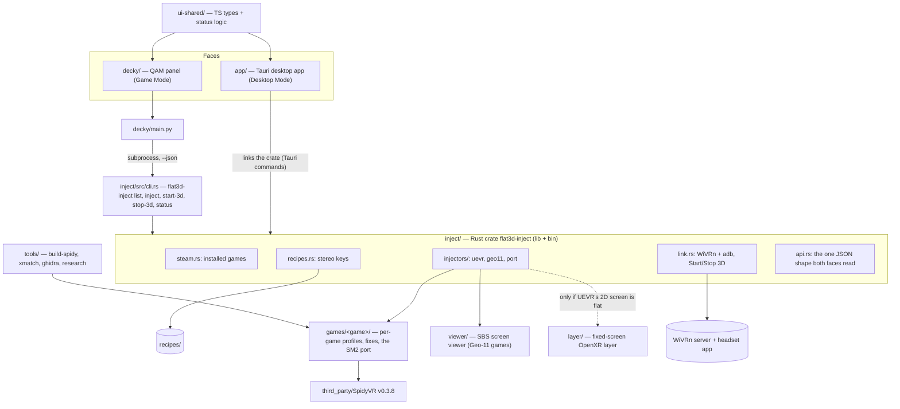

# Code map

The intended shape of the repo for 1.0 (SPEC.md, re-approved 2026-10-31): **one Rust engine, two faces**. A Tauri desktop app for Desktop Mode and a Decky plugin for Game Mode both drive the same engine, so a game, a recipe or a link state means the same thing everywhere. Rewritten 2026-10-31 for the owner's ruling "Desktop app + Decky plugin (Recommended)", built with "Tauri (Rust + web UI) (Recommended)". Main at that date: the engine, Decky backend and `recipes/` are skeletons (every engine function returns `Err(NotBuilt)`); everything marked *planned* does not exist yet.

The deep map of Spidy's stereo core is [spidy-stereo-core-map.md](spidy-stereo-core-map.md); the Spider-Man 2 address map is [spiderman2-address-map.md](spiderman2-address-map.md).

**Platforms (R04).** The host is Linux only: SteamOS on the owner's Z13 (rulings 1, 2). Mac and Windows hosts don't apply. Windows binaries (the Spider-Man 2 port's DLLs, the SBS viewer if it runs inside Proton) are cross-built on Linux with clang-cl + xwin and run under Proton (ruling 21). The desktop app ships as an AppImage (Tauri's Linux bundle; WebKitGTK is on SteamOS). The Decky plugin bundles the engine binary. CI is Linux only.

## How it fits together

## Parts

| Path | Status | Owns | Musts |
|---|---|---|---|
| `inject/` | skeleton | the engine: Rust crate `flat3d-inject`, library `flat3d_inject` + binary `flat3d-inject` (names kept: the locked tests in #24, #29, #36, #47-#49 import them). Everything the faces do goes through it; neither face runs a command itself. | M9-M12, M17-M18 |
| `inject/src/steam.rs` | stub | installed Steam games from `libraryfolders.vdf` + `appmanifest_*.acf`, every library folder (internal, SD card, external drives); Kaon (LorenDB/kaon) and Rai Pal are the references | M9 |
| `inject/src/recipes.rs` | stub | loads and checks `recipes/*.recipe` (`key: value`, the eight stereo keys plus route settings) | M12, M17, M20-M23 |
| `inject/src/injectors/` | stub (one file today) | one module per route, chosen by the recipe's `stereo-route`: `uevr.rs` (UEVR + .NET into the Proton prefix, profile, launch options: Zero Company, ACE COMBAT 7), `geo11.rs` (Geo-11 + the game's fix into the game folder, starts the viewer: Control, Planet of Lana), `port.rs` (our DLLs + launch script: Spider-Man 2, Zero Company's fallback hook). Each writes the Steam launch options and starts the game with `steam://rungameid/<appid>`; each can undo what it did. | M9, M14, M17, M20-M23 |
| `inject/src/link.rs` | stub | Start 3D and Stop 3D: WiVRn server without its desktop window, `adb reverse tcp:9757`, the WiVRn app on the Quest, a `LinkState` (no headset, unauthorised, starting, ready, stopped); commands behind a runner trait so tests fake them | M10, M18 |
| `inject/src/api.rs` | planned | the serialisable types both faces read (`Game`, `Recipe`, `LinkState`, `InjectResult`, errors) and the `--json` output; the TS types in `ui-shared/` are generated from or checked against it | M9-M11 |
| `inject/src/cli.rs`, `main.rs` | stub | `flat3d-inject list / inject <appid> / start-3d / stop-3d / status`, human text by default, `--json` for the Decky backend | M9-M11, M18 |
| `app/` | planned | Tauri 2 desktop app for Desktop Mode, the Rai Pal-style window | M24 |
| `app/src-tauri/` | planned | Rust side: depends on `inject/` by path and exposes it as Tauri commands (`list_games`, `inject`, `start_3d`, `stop_3d`, `status`, `read_log`); no logic of its own | M24 |
| `app/src/` | planned | web UI (React + TypeScript, Vite): **Library** (installed games, stereo status, filter by status, Inject), **Headset** (Start 3D, Stop 3D, link state, first-time setup: WiVRn APK install, USB debugging, seated boundary), **Game** (its recipe, route, settings, last result, undo), **Logs** | M24 |
| `decky/` | skeleton | the Game Mode plugin (`plugin.json`, Decky's TypeScript + Rollup template) | M11, M18 |
| `decky/main.py` | stub | backend: runs `bin/flat3d-inject --json …` as a subprocess and returns the parsed JSON; no logic of its own | M11 |
| `decky/src/` | planned | QAM panel: **Start 3D / Stop 3D** with the link state at the top, then the 1.0 games with their status and an **Inject** button each (Decky's UI components) | M11, M18 |
| `ui-shared/` | planned | small TS package used by both faces: the API types and pure helpers (status label and colour, sort order, link-state wording), so the two faces never disagree | M11, M24 |
| `recipes/` | skeleton (README only) | one file per game, the canonical home (#15); 1.0 ships five | M12, M17, M20-M23 |
| `games/zero-company/`, `games/ace-combat-7/` | planned | UEVR profile settings, launch notes, measured settings | M13-M16, M20 |
| `games/planet-of-lana/`, `games/control/` | planned | where the Geo-11 fix comes from (fetched, never vendored unless its license allows), settings | M22, M23 |
| `games/spiderman2/` | planned | the port: render probe, camera shift, eye views, pairing, OpenXR worker, HUD and memory, launch script | M3-M8 |
| `viewer/` | planned | SBS screen viewer: Geo-11's side-by-side picture on the fixed screen over OpenXR. Likely a Windows binary run in the game's Proton session reading Geo-11's shared texture (FlatToDepth / VRScreenCap, MIT, are the references) | M21 |
| `layer/` | planned, conditional | fixed-screen OpenXR layer, only if UEVR's 2D Screen Mode loses depth (#33, #9) | M15 |
| `third_party/SpidyVR` | present (submodule, v0.3.8) | the baseline mod (GPL-3.0) | M1, M3-M8 |
| `cmake/clang-cl-xwin.cmake`, `tools/build-spidy.sh` | present | cross-building Windows binaries on Linux in the `craft-build` distrobox | M3-M8, M21 |
| `tools/research/`, `tools/xmatch/`, `tools/ghidra/` | present | Spider-Man 2 discovery: Spidy's tools without hash gates, the Remastered → SM2 matcher, headless Ghidra under a memory guard | M3-M6, M8 |
| `.github/workflows/check.yml` | present | CI on Linux: engine build + test, Decky backend compile; grows to the app (`cargo check` of `app/src-tauri`, `npm run build` + typecheck of `app/`, `decky/`, `ui-shared/`) | all |
| `docs/` | present | rulings (`notes/DECISIONS.md`), research, the port plan, Step 0 run sheet, maps | all |

## Interlinks

- **One engine, two faces.** The app links the crate directly; the Decky backend can't (Decky backends are Python) so it calls the binary with `--json`. Both read the shapes in `inject/src/api.rs`.
- **Recipes drive routes.** `stereo-route` picks the injector module; adding a game is a recipe file plus, at most, a `games/<game>/` folder.
- **Start 3D before Inject.** Proton looks for VR only at launch, so `inject` refuses to start a game while the link isn't ready, and both faces grey the Inject button until it is.
- **Undo.** Every injector records what it changed (launch options, copied files) so the app's Game page can put a game back to flat.

## Packaging

- **App:** AppImage from `cargo tauri build`, run in Desktop Mode; it can add itself to Steam as a non-Steam game later (after 1.0).
- **Decky plugin:** Decky's zip with the engine binary at `bin/flat3d-inject`, built on Linux.
- Both come from the same tagged commit, so the faces and the engine never mismatch.

## Open-source pieces

- [SpidyVR](https://github.com/IlyaMez/SpidyVR) (GPL-3.0): the Spider-Man baseline (ruling 17).
- [UEVR](https://github.com/praydog/UEVR) (license not detected): Zero Company and ACE COMBAT 7; fetched at inject time, not vendored.
- Geo-11 and the games' 3D fixes: fetched, not vendored; check each license (rulings 8, 16).
- [WiVRn](https://github.com/WiVRn/WiVRn) (GPL-3.0): the streamer, wired mode (ruling 5).
- [Rai Pal](https://github.com/Raicuparta/rai-pal) (GPL-3.0, Tauri): the model for the app and for game detection; logic ported, not linked.
- [Kaon](https://github.com/LorenDB/kaon) (GPL-3.0): UEVR under Proton on Linux; the reference for `injectors/uevr.rs`.
- [FlatToDepth](https://github.com/Blackskydk/FlatToDepth), [VRScreenCap](https://github.com/artumino/VRScreenCap) (MIT): references for `viewer/`.
- [Tauri](https://github.com/tauri-apps/tauri) (MIT/Apache-2.0) and [Decky Loader](https://github.com/SteamDeckHomebrew/decky-loader): the two faces' hosts.
- Ghidra and REA (ruling 22): reverse engineering for the address map.
