# Code map

Flat to 3D uses one Rust engine, a systemd user service for the headset link, a Steam launch wrapper, and two interfaces: an iced desktop app and a Decky Game Mode panel. This map describes the verified `v2/integration` tree at `c9c46b7`. See the [roadmap](ROADMAP.md) for build status, blocked work and device sessions.

The deep map of Spidy's stereo core is [spidy-stereo-core-map.md](spidy-stereo-core-map.md); the Spider-Man 2 address map is [spiderman2-address-map.md](spiderman2-address-map.md).

**Platforms (R04).** The host is SteamOS Linux with Quest 2 over USB. Game DLLs and the UEVR injector are built for Windows and run under Proton. The PipeWire/OpenXR viewer, iced AppImage and Decky plugin run on Linux. Quest Tether's udev rule grants USB access to the user service.

## How it fits together

```mermaid
flowchart TD
    Steam["Steam: Play on a 3D Ready game"] --> Run["flat3d-run %command% (crates/engine/src/bin/flat3d-run.rs)"]
    Run -->|"reads"| State[("$XDG_RUNTIME_DIR/flat3d/link.json")]
    Run -->|"reads"| Cfg[("~/.config/flat3d/settings: switches")]
    Run -->|"3D: route files + env, else unchanged"| Game["the game (Proton)"]
    Run -->|"writes run record"| Runs[("runs/run-PID.txt")]
    Unit["systemd user unit flat3d-link"] --> Watch["crates/engine/src/watch.rs: flat3d-inject watch"]
    Watch -->|"adb track-devices"| Quest["Quest 2 over USB"]
    Watch --> Tether["crates/engine/src/tether/: adb choice, gnirehtet relay, Wi-Fi sync, heal"]
    Watch --> Link["crates/engine/src/link.rs: WiVRn server + adb reverse + WiVRn app"]
    Watch --> Health["health.rs, stats.rs: battery, temperature, throughput, soak"]
    Watch -->|"atomic write"| State
    Watch -->|"reads"| Cfg
    Watch -->|"reads"| Runs
    Tether -.->|"Quest Tether already tethering: use its tunnel and adb"| QT[(Quest Tether)]
    subgraph Faces
      App["crates/app/ — iced app (Rust): Setup, Headset, Games, Logs"]
      QAM["decky/ — thin TS panel: renders --json; SteamClient calls for launch options, collection, toasts"]
    end
    App -->|"snapshot, requests, logs and view models"| Engine
    App -->|"commands via engine.rs"| CLI
    QAM -->|"runs the binary, --json"| CLI["crates/engine/src/cli.rs + cli/link.rs + cli/view.rs"]
    CLI --> Engine
    subgraph Engine["crates/engine/ — Rust crate flat3d-inject (lib + bins flat3d-inject, flat3d-run)"]
      Steam2[steam.rs: installed games]
      Rec[recipes.rs: stereo keys]
      Inj[injectors/: uevr, geo11, port]
      Api[api.rs: the JSON shapes]
    end
    Run --> Inj
    Rec --> RecFiles[(recipes/)]
    Inj --> Games["games/&lt;game&gt;/ — per-game profiles, fixes, the SM2 port"]
    Inj --> Viewer["crates/viewer — SBS screen viewer (Linux, PipeWire→OpenXR)"]
    Inj -.only if UEVR's 2D screen is flat.-> Layer["layer/ — fixed-screen OpenXR layer"]
    Link --> WiVRn[(WiVRn server + headset app)]
    Tools["tools/ — build-spidy, xmatch, ghidra, research"] --> Games
```



<!-- mv-map -->
- `inject/**` → `crates/engine/**`
- `app/**` → `crates/app/**`
- `cli_link.rs` → `cli/link.rs`
- `{collection,headset_view,link_view,toasts,view}.rs` → `face/`
- `tether/mod.rs` → `tether.rs`
- `watch.rs` → `watch/service.rs`, then frames/machine/files/run are split out; new `watch.rs` is facade-only.
<!-- /mv-map -->

## Parts

Status describes the code in the verified tree. Device checks are listed in Owns and in the roadmap.

| Path | Status | Owns | Musts |
|---|---|---|---|
| `crates/engine/` | partly present | Rust crate `flat3d-inject`: shared library `flat3d_inject`, command binary and Steam wrapper. The command table below records the remaining stubs. | M9-M12, M17-M18, M25-M29 |
| `crates/engine/src/steam.rs` | present (`installed_games`, #24) | installed Steam games from `libraryfolders.vdf` + `appmanifest_*.acf`, every library folder (internal, SD card, external drives); Kaon (LorenDB/kaon) and Rai Pal are the references | M9 |
| `crates/engine/src/recipes.rs` | present | `parse_recipe`, `check_recipe` and `load_recipes` (E1a-E1c): loads and checks `recipes/*.recipe` (`key: value`, the eight stereo keys plus route settings) | M12, M17, M20-M23 |
| `crates/engine/src/injectors/` | partly present | Route selection, UEVR and Geo-11 file work. WP-27 blocks the full inject flow and WP-31 blocks launch integration. Port route remains a stub. | M9, M14, M17, M20-M23 |
| `crates/engine/src/undo.rs` | present for `UndoRecord`, `Replaced`, the record text (`to_text`, `from_text`) and `record_path` (E4c); `UndoAction` and `undo_actions` (E4d); `undo_game` (the file steps run on disk, the record deleted after) and `data_dir` (#84); `uevr::apply` builds a record and returns it, nothing saves it yet (#27) | the undo record: how to put a game back to flat. `UndoRecord` holds the appid, the launch options before we touched them, the files created and the files replaced with their backups; `undo_actions` lists the ordered steps (created files newest first, then restores newest first, then the launch options last), without touching disk | M9 |
| `crates/engine/src/link.rs` | present | the WiVRn half of Start 3D and Stop 3D: WiVRn server without its desktop window (a user unit), `adb reverse tcp:9757`, the WiVRn app on the Quest; the replug's reattach list (reverse + app only) is `watch::link_commands(Reattach)`; a `LinkState` (no headset, unauthorised, starting, ready, stopped); commands behind a runner trait so tests fake them. The tether is not here (`tether/`); `watch` composes the two. Names kept: the locked tests in #64-#66 import them. | M10, M18 |
| `crates/engine/src/watch.rs` + `crates/engine/src/watch/` | present | the link service's brain: `parse_track_frames` (adb track-devices), the pure state machine `step` (plug, unplug, Auto 3D, the 2-minute grace, late plug-in, manual Start/Stop) returning `Effect`s, `link_commands`, and `watch::run`, the loop that spawns `adb track-devices`, ticks every second, runs the effects through the runners and writes the state file | M10, M18 |
| `crates/engine/src/state.rs` | present | the state directory paths, the `request` file (`start-3d` / `stop-3d`) and the staleness rule; the event ring (`EventRing`, E5g: the last 10 link events, numbered from one, `since`, resumed from a saved list). The state file's type `LinkSnapshot` (with `stopped` and `effective`, E5f) lives in `api.rs`; reading and writing `link.json` is in `watch.rs` (#119). The one way the wrapper and both faces ask the link service anything | M9-M11, M18, M24 |
| `crates/engine/src/runs.rs` | present | `RunRecord`: one small file per running game (`runs/run-<pid>.txt`) that the wrapper writes, so the watcher knows which games run in 3D and which flat | M18 |
| `crates/engine/src/switches.rs` | present | Auto 3D, tunnel and per-game switches. The link CLI reads and writes the settings file. | M10, M11, M25, M30 |
| `crates/engine/src/wrapper.rs` | partly present | Launch decision, command preparation, run records, logs and flat fallback. Route application returns a stub error until WP-31. | M9, M18, M30 |
| `crates/engine/src/bin/flat3d-run.rs` | present | the wrapper binary Steam runs: `flat3d-run %command%`; takes the appid from `SteamAppId` (else `SteamGameId`), calls `wrapper::run`, execs the game with its arguments passed as-is (no shell); prints only an exec error | M9, M30 |
| `crates/engine/src/tether/` | partly present | ADB selection, gnirehtet relay and client, connect/disconnect plans, Wi-Fi sync and heal/step-aside helpers. The health loop uses these helpers. WP-10 and WP-09 remain open. | M25, M28, M29 |
| `crates/engine/src/health.rs`, `crates/engine/src/stats.rs` | present (`health.rs`: `health_command`, `parse_dumpsys_battery`, `temperature_zone`, `ToastGate`, `toast_text`; `stats.rs`: `RateMeter`, `SoakSummary`, `Soak`, `mem_used_kb`, `soak_path`) | `health.rs`: `dumpsys battery` parse, the green/yellow/red zones (38 C, 42 C), the toast-once gate (`ToastGate`, present); `stats.rs`: throughput from `tun0` counters, the soak summary and its log text | M26, M27 |
| `crates/engine/src/install.rs` | present | Builds and executes install/uninstall plans for the binaries, tools and systemd user unit. Device check Q3. | M10, M28 |
| `crates/engine/src/setup.rs` | partly present | Quest package parsing and setup helpers. WP-29 owns the setup and doctor command bodies. | M24 |
| `crates/engine/src/api.rs` | present | the serialisable types both faces read (`Game`, `Recipe`, `LinkState`, `InjectResult`, errors) and the `--json` output; the app uses them directly, the Decky panel reads the same keys | M9-M12 |
| `crates/engine/src/cli.rs` + `crates/engine/src/main.rs` | present | Command registry, parser, JSON envelope, exit handling and dispatch. See Commands for individual implementation status. | M9-M11, M18 |
| `packaging/` | present | `build-tools.sh`, `build-appimage.sh`, `build-decky.sh`, pins and the service template. Device checks Q1, Q14 and Q16. | M10, M28 |
| `crates/app/` | present | Native iced desktop app with Setup, Headset, Games and Logs. Device checks Q15 and Q16. | M24 |
| `crates/app/src/` | present | `lib.rs` routes messages into effects. `main.rs` renders the tabs and ticks every second. `engine.rs` runs I/O on worker threads. | M24 |
| `decky/` | present | Plugin metadata, pinned frontend build and `main.py` shim invoking `bin/flat3d-inject` with `--json`. Device check Q14. | M11, M18, M30 |
| `decky/src/` | present | Engine wrappers, Quick Access panel, launch-option and collection sync, and toast polling. The panel refreshes link and game rows every second. | M11, M18, M26, M30 |
| `crates/engine/src/launch_options.rs` | present (`add_wrapper`, `remove_wrapper`, `has_wrapper`, E4b) | the rule the Decky plugin used to carry, now Rust: add and remove the `flat3d-run` word in a launch-option line (keeping `mangohud` and the rest) | M30 |
| `crates/engine/src/face/collection.rs`, `crates/engine/src/face/toasts.rs` | present (`collection.rs`: `three_d_ready_appids`, `collection_diff`, `COLLECTION_NAME`; `toasts.rs`: `toasts_since`, `ToastBatch`) | the 3D Ready set and the collection diff, which toasts are new | M18, M26, M30 |
| `crates/engine/src/face/view.rs` | present | Shared health, speed and uptime wording and zone colours. | M26, M27 |
| `crates/engine/src/cli/view.rs` | present | Read-only view commands for link, rows, launch-option text, collection diffs, toasts and logs. | M11 |
| `crates/engine/src/face/rows.rs` | present | Builds shared game rows from installed games, recipes, settings and link state. | M11, M24, M26 |
| `crates/engine/src/face/link_model.rs` | present | Builds the shared link view from the current snapshot. | M11, M24, M26 |
| `crates/engine/src/face/logs.rs` | present | Shared log reading, parsing and filtering. | M11, M24, M26 |
| `crates/engine/src/link/wivrn.rs` | present | WiVRn installation and headset-app detection. | M10, M18 |
| `crates/engine/src/watch/health_loop.rs` | present | Health, tunnel, healing and soak tick. Device check Q3. | M10, M18 |
| `crates/engine/src/injectors/geo11.rs` | present | Geo-11 settings, file planning and apply with undo. Device check Q9 and wrapper integration WP-31. | M9, M17, M20-M23 |
| `crates/engine/src/injectors/port.rs` | stub | Port route entry point. The Spider-Man 2 port remains game-track work. | M9, M14, M17 |
| `crates/engine/src/injectors/fetch.rs` | present | Pinned download and cache helpers. The `setup fetch` CLI awaits WP-27. Device check Q0. | M9, M14, M17 |
| `crates/app/src/engine.rs` | present | Snapshot, request and log I/O; CLI lookup, argv and JSON envelope adapter. | M24 |
| `crates/app/src/headset_page.rs` | present | Headset page state and update logic. | M24 |
| `crates/app/src/games_page.rs` | present | Games page state and update logic. | M24 |
| `crates/app/src/setup_page.rs` | present | Setup page state and update logic. | M24 |
| `crates/app/src/logs_page.rs` | present | Logs page state and update logic. | M24 |
| `crates/app/src/view_headset.rs` | present | Headset page iced widgets. | M24 |
| `crates/app/src/view_games.rs` | present | Games page iced widgets. | M24 |
| `crates/app/src/view_setup.rs` | present | Setup page iced widgets. | M24 |
| `crates/app/src/view_logs.rs` | present | Logs page iced widgets. | M24 |
| `crates/engine/src/status.rs`, `crates/engine/src/cli/link.rs`, `crates/engine/src/face/headset_view.rs`, `crates/engine/src/face/link_view.rs` | present | `status.rs`: status labels, colours, sorting and filtering; `headset_view.rs`: button state and log lines; `link_view.rs`: link labels, hints and flat reason | M11, M24, M26 |
| `recipes/` | present | Canonical location for game recipes. The five WP-26 seeds are fixtures under `crates/engine/tests/fixtures/recipe-seeds/`; device checks precede promotion. | M12, M17, M20-M23 |
| `games/zero-company/`, `games/ace-combat-7/` | planned | UEVR profile settings, launch notes, measured settings | M13-M16, M20 |
| `games/planet-of-lana/`, `games/control/` | planned | where the Geo-11 fix comes from (fetched, never vendored unless its license allows), settings | M22, M23 |
| `games/spiderman2/` | planned | the port: render probe, camera shift, eye views, pairing, OpenXR worker, HUD and memory, launch script | M3-M8 |
| `crates/viewer/` | present | Linux-native PipeWire→OpenXR quad viewer on WiVRn. Build `flat3d-viewer` with `xr,capture`. Device check Q10. | M21 |
| `crates/uevr-inject/` | present | Windows UEVR injector executable. Build with `tools/build-win.sh`. Device checks Q2 and Q6. | M20 |
| `sessions/` + `tools/session/session.py` | present | Session definitions and runner for the roadmap's Q0–Q16 checks. | all |
| `layer/` | planned, conditional | fixed-screen OpenXR layer, only if UEVR's 2D Screen Mode loses depth (#33, #9) | M15 |
| `third_party/SpidyVR` | present (submodule, v0.3.8) | the baseline mod (GPL-3.0) | M1, M3-M8 |
| `cmake/clang-cl-xwin.cmake`, `tools/build-spidy.sh` | present | cross-building Windows binaries on Linux in the Linux build container | M3-M8, M21 |
| `tools/research/`, `tools/xmatch/`, `tools/ghidra/` | present | Spider-Man 2 discovery: Spidy's tools without hash gates, the Remastered → SM2 matcher, headless Ghidra under a memory guard | M3-M6, M8 |
| `crates/engine/tests/*.rs` | present | Engine unit contracts and integration fixtures, including CLI parity, route files, link commands and repository checks. | all |
| `.github/workflows/check.yml` | present | Linux CI for the Rust workspace, formatting, Clippy, Decky and docs tooling. | all |
| `docs/` | present | rulings (`notes/DECISIONS.md`), research, the port plan, Step 0 run sheet, maps | all |

## Commands

The registry in `crates/engine/src/cli.rs` defines the command IDs, output types and effects. The WP column records work outstanding at this checkpoint.

| Command | Group | Module | JSON (api.rs type) | Effects | WP |
|---|---|---|---|---|---|
| `list` | Engine | `cli/engine.rs` | Game (array) | ReadOnly | WP-07 |
| `inject` | Engine | `cli/inject.rs` | InjectResult | WritesFiles, RunsCommands | WP-27 blocked |
| `start-3d` | Engine | `cli/link.rs` | LinkReport | WritesFiles | WP-08 |
| `stop-3d` | Engine | `cli/link.rs` | LinkReport | WritesFiles | WP-08 |
| `status` | Engine | `cli/engine.rs` | LinkReport | ReadOnly | WP-07 |
| `undo` | Engine | `cli/undo.rs` | UndoResult | WritesFiles | Existing undo works. WP-27 follow-up blocked. |
| `watch` | Link | `cli/link.rs` | — | WritesFiles, RunsCommands | WP-08 |
| `snapshot` | Link | `cli/link.rs` | LinkSnapshot | ReadOnly | WP-08 |
| `install` | Link | `cli/link.rs` | InstallReport | WritesFiles, RunsCommands | WP-08 |
| `uninstall` | Link | `cli/link.rs` | InstallReport | WritesFiles, RunsCommands | WP-08 |
| `switch get` | Link | `cli/link.rs` | SwitchState | ReadOnly | WP-08 |
| `switch set` | Link | `cli/link.rs` | SwitchState | WritesFiles | WP-08 |
| `setting get` | Link | `cli/link.rs` | SettingState | ReadOnly | WP-08 |
| `setting set` | Link | `cli/link.rs` | SettingState | WritesFiles | WP-08 |
| `run` | Link | `cli/link.rs` | — | WritesFiles, RunsCommands | WP-08 |
| `view` | View | `cli/view.rs` | LinkView | ReadOnly | WP-28 |
| `rows` | View | `cli/view.rs` | GameRow (array) | ReadOnly | WP-28 |
| `launch` | View | `cli/view.rs` | LaunchText | ReadOnly | WP-28 |
| `collection` | View | `cli/view.rs` | CollectionPlan | ReadOnly | WP-28 |
| `toasts` | View | `cli/view.rs` | ToastBatch | ReadOnly | WP-28 |
| `logs` | View | `cli/view.rs` | LogLines | ReadOnly | WP-28 |
| `setup packages` | Setup | `cli/setup.rs` | {wivrn,gnirehtet,missing} | Probes | WP-29 skipped |
| `setup install-apps` | Setup | `cli/setup.rs` | SetupReport | WritesFiles, RunsCommands | WP-29 skipped |
| `setup launch-env` | Setup | `cli/setup.rs` | LaunchText | Probes | WP-29 skipped |
| `setup fetch` | Setup | `cli/setup.rs` | SetupReport | WritesFiles, RunsCommands | WP-27 blocked |
| `doctor` | Doctor | `cli/doctor.rs` | DoctorReport | Probes | WP-29 skipped |

Other binaries: `flat3d-run %command%`, `flat3d-viewer` (arguments from `ViewerSpec::to_args`), and `flat3d-uevr-inject.exe` (arguments in `crates/uevr-inject/src/args.rs`).

## API shape (crates/engine/src/api.rs)

Fixed 2026-10-31 when #50 was split (E1d #61 types, E1e #62 envelope, E1f #63 `--json`) and extended 2026-11-01 for "Plug in and play"; the locked tests in those issues hold the old names (kept as they are), and the desktop app and Decky panel read exactly this. Rust field name = JSON key.

Each JSON-capable `flat3d-inject <command> --json` invocation prints exactly one line holding one JSON object, the envelope `Response<T>`:

```json
{"ok": true,  "command": "list", "data": [ ... ]}
{"ok": false, "command": "list", "error": {"code": "not-built", "message": "not built yet: ..."}}
```

`data` is left out on failure and `error` on success. A bad command line gives `"command": ""` and code `usage`. Exit code: 0 ok; 2 for `usage` and `not-built`; 1 for every other error. Without `--json`, results go to stdout as text and errors to stderr as `error: <message>`. `watch` and `run` are not JSON commands: `watch` runs until stopped (the systemd unit), `run` ends by exec-ing the game and prints nothing.

| Command | `command` | `data` |
|---|---|---|
| `list` | `"list"` | array of `Game` |
| `inject <appid>` (WP-27 stub) | `"inject"` | `InjectResult` |
| `start-3d`, `stop-3d`, `status` | `"start-3d"`, `"stop-3d"`, `"status"` | `LinkReport` |
| `undo <appid>` (#84) | `"undo"` | `UndoResult` (files put back; the launch option is the Decky plugin's to remove) |
| `snapshot` (new) | `"snapshot"` | `LinkSnapshot`: the whole state file, with health and stats |
| `switch get <appid>`, `switch set <appid> on\|off` (new) | `"switch"` | `SwitchState` |
| `setting get <key>`, `setting set <key> on\|off` (new; keys `auto-3d`, `tunnel`) | `"setting"` | `SettingState` |
| `install`, `uninstall` (new) | `"install"`, `"uninstall"` | `InstallReport` |
| `view` (new) | `"view"` | `LinkView`: the link wording, button states and health wording for the current snapshot |
| `rows [--filter <status>\|all]` (new) | `"rows"` | array of `GameRow`, sorted, with labels, colours, each game's switch and why it would play flat |
| `launch add\|remove --options <options>` (new) | `"launch"` | `LaunchText` |
| `collection [--current <appids>]` (new) | `"collection"` | `CollectionPlan` |
| `toasts <last_seq>` (new) | `"toasts"` | `ToastBatch` |
| `logs [--limit <n>]` (new) | `"logs"` | `LogLines` |
| `watch` (new) | none | runs the link service |
| `run <appid> -- <command...>` (new; `flat3d-run` calls it with the appid from `SteamAppId`) | none | execs the game |

| Type | Keys |
|---|---|
| `Game` | `appid` (number), `name`, `install_dir` (path as text), `status` (the recipe's `stereo-status`, `untested` when there is no recipe), `has_recipe` (bool) |
| `Recipe` | `appid`, `name`, `status`, `route`, `engine`, `api`, `mod_url`, `free`, `safe`, `checked`: the fields of `recipes::Recipe` |
| `LinkState` | a string: `"no-headset"`, `"unauthorised"`, `"starting"`, `"ready"`, `"stopped"` |
| `LinkReport` | `state` (`LinkState`), `message` (one line for people); unchanged by the rework |
| `InjectResult` | `appid`, `route`, `launched` (bool), `summary` |
| `UndoResult` | `appid`, `restored` (array of text, one line per change put back, from the undo record #81), `summary` |
| `TetherMode` | a string: `"off"` (tunnel switch off), `"own"` (our relay), `"quest-tether"` (stepped aside, ruling 31) |
| `Zone` | a string: `"green"` (below 38 C), `"yellow"` (38-42 C), `"red"` (above 42 C), `"unknown"` |
| `Health` | `battery` (number 0-100 or null), `status` (text: `Charging`, `Discharging`, `Not Charging`, `Full`, `Unknown`), `temp_c` (number or null), `zone` (`Zone`) |
| `Stats` | `rx_bytes_s`, `tx_bytes_s` (numbers, bytes per second on `tun0`), `uptime_s`, `reconnects` |
| `LinkEvent` | `seq` (number, rises by one), `kind` (`ready`, `late-plug`, `grace-ended`, `allow-debugging`, `warm`, `hot`), `text` (the toast wording, made by the engine so both faces say the same thing) |
| `LinkSnapshot` | `state` (`LinkState`), `message`, `tether` (`TetherMode`), `tunnel` (bool: `tun0` carries traffic), `auto_3d` (bool), `adb` (path text, empty if none), `adb_source` (`"running"`, `"bundled"` or `"missing"`), `health` (`Health` or null), `stats` (`Stats` or null), `events` (last 10 `LinkEvent`), `updated` (unix seconds) |
| `SwitchState` | `appid`, `on` (bool) |
| `SettingState` | `key` (`"auto-3d"` or `"tunnel"`), `on` (bool) |
| `InstallReport` | `written` (array of paths), `ran` (array of command lines), `summary` |
| `HealthView` | `battery` (`"85%"` or `"unknown"`), `temp` (`"31.2 C"` or `"unknown"`), `zone` (`Zone`), `colour` (hex text) |
| `LinkView` | `state` (`LinkState`), `label`, `hint`, `start` (bool: Start 3D is live), `stop` (bool), `health` (`HealthView`), `rx`, `tx` (speed text such as `"1.5 KB/s"`), `uptime` (text such as `"3m 5s"`), `tether`, `tunnel`, `auto_3d`, `adb_source` |
| `GameRow` | `appid`, `name`, `status`, `status_label`, `status_colour` (hex), `switch_on` (bool), `plays_3d` (bool), `flat_reason` (text or null) |
| `LaunchText` | `options` (the launch-option line after the change) |
| `CollectionPlan` | `name` (`"3D Ready"`), `wanted` (array of appids), `add`, `remove` (arrays, empty when `--current` is not given) |
| `ToastBatch` | `toasts` (array of `LinkEvent`, oldest first), `last_seq` |
| `LogLines` | `lines` (newest first, blank lines dropped), `text` (the same lines joined for copying) |
| `ApiError` | `code`, `message`; `code` is one of `usage`, `not-built`, `not-found`, `bad-recipe`, `refused`, `link-not-ready`, `command-failed`, `io` |

**Errors the Decky backend makes itself** (#67): a missing engine binary is `io`; a timeout, a non-zero exit with no JSON, or unparseable output is `command-failed`. Same envelope, so the panel handles them like engine errors.

**State, IPC and files.** There is no daemon socket; the link service and its clients talk through files, all written atomically (temp file, then rename):

| File | Writer | Readers | Holds |
|---|---|---|---|
| `$XDG_RUNTIME_DIR/flat3d/link.json` (else `/tmp/flat3d-<uid>/link.json`) | `watch`, once a second and on every change | `snapshot`, `status`, `flat3d-run`, both faces | the `LinkSnapshot`. A snapshot older than 10 s counts as `stopped` (the service is not running), so a crashed service never leaves the wrapper believing in a link. |
| `$XDG_RUNTIME_DIR/flat3d/request` | `start-3d`, `stop-3d` with a fresh service snapshot, or the desktop app | `watch`, which takes it on its next tick and deletes it | one line, `start-3d` or `stop-3d`. Keeps the service the only actor, so a hand-pressed button and the grace timer never fight. Without a fresh service snapshot, the CLI returns `link-not-ready`. The desktop app writes the request through its engine adapter. |
| `$XDG_RUNTIME_DIR/flat3d/runs/run-<pid>.txt` | `flat3d-run` | `watch` (a record whose pid is gone is ignored) | `appid`, `pid`, `mode` (`3d` or `flat`): which games are running and how |
| `~/.config/flat3d/settings` | `setting set`, `switch set` | everyone | Auto 3D, tunnel, the games whose 3D switch is off |
| `~/.local/state/flat3d/soak-<unix>.txt` | `watch` | the Headset page | one soak summary per link session |
| `~/.local/state/flat3d/link.log` | `watch` | the desktop Logs page and `logs` | the link events, one per line |

**Start 3D and Stop 3D** (E2a #64, E2b #65, E2c #66). The WiVRn half, over WiVRn's wired mode. Start: `adb devices` (no headset or unauthorised stops here), `systemd-run --user --collect --unit=flat3d-wivrn flatpak run --command=wivrn-server io.github.wivrn.wivrn` (the server without its desktop window), `adb reverse tcp:9757 tcp:9757`, `adb shell am start -a android.intent.action.VIEW -d wivrn+tcp://localhost org.meumeu.wivrn.github`. Stop: `adb shell am force-stop org.meumeu.wivrn.github`, `adb reverse --remove tcp:9757`, `systemctl --user stop flat3d-wivrn.service` (the adb steps may fail with the headset unplugged; the server stop decides). They run behind `link::CommandRunner`, so tests fake them. The word `adb` in a command is replaced by the adb in use (`tether::adb::AdbRunner`). A replug heals with `watch::link_commands(Effect::Reattach)` (the last two start commands) because the server is already running.

**What `watch` does on each event** (E5b-E5d, `watch::step`):

| Event | Link up? | Result |
|---|---|---|
| headset plugged in | no | tether up if the tunnel switch is on; with Auto 3D on also WiVRn, `adb reverse`, the app, and a "ready" event; if a 3D-ready game is already running flat, also a `late-plug` event ("restart for 3D") and the game is left alone |
| headset gone, no 3D game running | yes | Stop 3D and tether stop |
| headset gone, a 3D game running | yes | nothing: the game keeps running, the 2-minute grace starts |
| headset back inside the grace | grace | `reattach_commands`; the grace ends |
| grace over (120 s), or the 3D game quit | grace | Stop 3D, tether stop, and for the first a `grace-ended` event ("restart the game for flat") |
| Start 3D / Stop 3D by hand | any | the same commands, in any order |

**Step-aside** (E6j): if a `gnirehtet` relay that is not ours is running, `tether` is `quest-tether`: the service reuses its relay and adb, and only WiVRn and `adb reverse` are added; the adb in use is the running server's binary (`/proc/<pid>/exe` of the listener on port 5037).

**Wrapper fallback.** Missing or stale link state, an unreadable switch, a missing recipe or a failed route leads to a flat launch. The wrapper records the reason in its run log and reports an exec failure if the game command cannot start.

## Interlinks

- **One engine, two faces.** The app links the crate for file I/O and shared view models, and calls the binary with `--json` for command effects. The Decky Python shim calls the same binary for the panel. Both read the shapes in `crates/engine/src/api.rs` and the same `snapshot`. No rule lives in a face: wording, colours, sort, launch-option text, the collection diff and toast selection are engine functions, so the faces cannot disagree. The panel's only own code is what only JavaScript can do (Steam's client API).
- **Recipes drive routes.** `stereo-route` picks the injector module; adding a game is a recipe file plus, at most, a `games/<game>/` folder. Only `works-now` games get the wrapper and a switch in 1.0 (ruling 38).
- **Wrapper and link.** The 3D path requires a fresh `ready` snapshot, an enabled game switch and a successful recipe route. In this checkpoint the route hook still returns `not-built` (WP-31), so the real wrapper falls back to a flat launch. The user service owns headset link changes.
- **One actor.** Only `watch` changes the link. Faces and commands ask it through the request file and read the snapshot.
- **Undo.** Two parts: the route's files (the undo record, `undo <appid>`, #81-#84) and the launch option. The Decky plugin removes only our word from the line, with the text from `launch remove`, and leaves the rest (for example `mangohud`). Turning a game's 3D switch off does not touch the launch option: the wrapper reads the switch, and the plugin only drops the game from the `3D Ready` collection.
- **Quest Tether stays installable** (ruling 31). Its tunnel and adb are used when it is running; the udev rule it installs is what lets this link run without root.

## Packaging

- **Link service and wrapper:** `flat3d-inject install` copies `flat3d-inject` and `flat3d-run` to `~/.local/bin/`, the tools (`adb`, `gnirehtet`, `gnirehtet.apk`) to `~/.local/share/flat3d/bin/`, writes `~/.config/systemd/user/flat3d-link.service` and runs `systemctl --user enable --now flat3d-link.service`. `uninstall` reverses it. The `install` command is exercised in the link smoke session (Q3).
- **Tools, never in git:** `packaging/build-tools.sh` builds adb from Android's open source (Apache-2.0, a standalone build such as nmeum/android-tools at a pinned tag) and the gnirehtet relay from Genymobile's source (Apache-2.0, `cargo build --release` at a pinned tag), and fetches the gnirehtet client APK by pinned checksum, all into `dist/tools/` (git-ignored) in the Linux build container.
- **App:** AppImage of the iced binary (no WebKitGTK), run in Desktop Mode; it carries the tools. It can add itself to Steam as a non-Steam game later (after 1.0).
- **Decky plugin:** Decky's zip with the engine binaries at `bin/flat3d-inject` and `bin/flat3d-run` and the tools beside them, built on Linux.
- All come from the same tagged commit, so the faces, the engine and the tools never mismatch.

## Open-source pieces

- [SpidyVR](https://github.com/IlyaMez/SpidyVR) (GPL-3.0): the Spider-Man baseline (ruling 17).
- [UEVR](https://github.com/praydog/UEVR) (license not detected): Zero Company and ACE COMBAT 7; fetched at inject time, not vendored.
- Geo-11 and the games' 3D fixes: fetched, not vendored; check each license (rulings 8, 16).
- [WiVRn](https://github.com/WiVRn/WiVRn) (GPL-3.0): the streamer, wired mode (ruling 5).
- [gnirehtet](https://github.com/Genymobile/gnirehtet) (Apache-2.0): the reverse-tether relay (Rust) and the Quest-side client APK; built or fetched by `packaging/build-tools.sh`, never vendored in git.
- Android's `adb` (Apache-2.0, from the Android Open Source Project): built from source by `packaging/build-tools.sh`; no SDK licence is involved (ruling 34). Never in git.
- Quest Tether (`iannitram/quest-tether`): the reference for the Rust tether port (`tether_manager.py`, `adb_manager.py`, `net_sync.py`, its SPEC M1-M7); it keeps its own Linux app and can run beside this one (ruling 31).
- [Rai Pal](https://github.com/Raicuparta/rai-pal) (GPL-3.0): the model for the app's pages and for game detection; logic ported, not linked.
- [Kaon](https://github.com/LorenDB/kaon) (GPL-3.0): UEVR under Proton on Linux; the reference for `injectors/uevr.rs`.
- [FlatToDepth](https://github.com/Blackskydk/FlatToDepth), [VRScreenCap](https://github.com/artumino/VRScreenCap) (MIT): references for `crates/viewer/`.
- [iced](https://github.com/iced-rs/iced) (MIT): the app's GUI toolkit. [Decky Loader](https://github.com/SteamDeckHomebrew/decky-loader): the panel's host; [PowerTools](https://github.com/NGnius/PowerTools) (GPL-3.0) is the model for a Rust backend with a thin TS panel.
- Ghidra and REA (ruling 22): reverse engineering for the address map.
